# Learn Developer Interview Prep 🎯

<div align="center">

[](https://opensource.org/licenses/MIT)
[](https://nodejs.org/)
[](https://www.python.org/)
[](https://github.com/TheLearningHubOrg/learn-interview-prep)
[](https://github.com/TheLearningHubOrg/learn-interview-prep)
[](https://github.com/TheLearningHubOrg/learn-interview-prep)

**An exhaustive, production-grade masterclass from absolute zero to staff-level performance in developer interviews.**  
Master hiring-loop mechanics, data structures and Big-O, 13 reusable coding patterns, live-coding communication, system design, behavioural storytelling, take-home projects, offer negotiation and a 12-week structured study plan.

[Getting Started](#1-stage-1-absolute-beginner-foundations--the-interview-landscape) • [Data Structures](#2-stage-2-core-data-structures--complexity-deep-dive) • [Coding Patterns](#3-stage-3-the-coding-patterns-masterclass) • [Live Coding](#4-stage-4-live-coding-execution--communication) • [System Design](#5-stage-5-system-design-interviews-from-requirements-to-trade-offs) • [Behavioural & Offers](#6-stage-6-behavioural-mastery-take-home-projects--the-study-plan) • [Staff Handbook](#7-stage-7-staff-engineer-interview-handbook--cheatsheet)

<br/>

<a href="https://www.buymeacoffee.com/manthanank">
  
</a>

</div>

---

## 🗺️ 7-Stage Pedagogical Roadmap

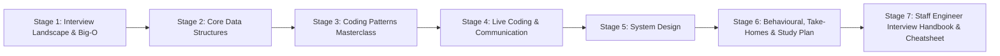

| Stage | Domain Focus | Core Concepts & Production Outcomes |
| :--- | :--- | :--- |
| **Stage 1** | **Interview Landscape & Big-O Foundations** | Hiring-loop stages, scoring rubrics, levelling expectations, Big-O from input limits, choosing an interview language, running the `practice/` suite with `npm test` and `pytest`. |
| **Stage 2** | **Core Data Structures & Complexity** | Dynamic arrays and amortised cost, hash maps (`dict`, `Map`), stacks and `deque`, linked lists with fast/slow pointers, trees and BST invariants, binary heaps, adjacency lists. |
| **Stage 3** | **The Coding Patterns Masterclass** | Signal-to-pattern mapping, hashing, two pointers, sliding window, binary search on the answer, intervals, monotonic stack, top-k heaps, BFS/DFS and Kahn's topological sort, backtracking, DP, union-find, tries, LRU design. |
| **Stage 4** | **Live Coding Execution & Communication** | A six-step problem framework, 45-minute time budget, clarifying questions, narrating trade-offs, dry-run trace tables, debugging under pressure, online assessments, spaced-repetition practice. |
| **Stage 5** | **System Design Interviews** | Requirements and scoping, back-of-the-envelope maths, load balancers, caches, queues, replication, partitioning, consistent hashing, URL shortener and rate limiter walkthroughs, trade-off vocabulary. |
| **Stage 6** | **Behavioural, Take-Homes & the Study Plan** | STAR stories and a story bank, answering for seniority, take-home project structure and README, reverse-interview questions, levelling and negotiation, a 12-week schedule, interview-day logistics. |
| **Stage 7** | **Staff Engineer Interview Handbook** | Pattern and design cheatsheet, 40 staff-level questions across algorithms, distributed systems, leadership and hiring-loop strategy, each with a model answer. |

---

## 📋 Table of Contents

- [1. Stage 1: Absolute Beginner Foundations & the Interview Landscape](#1-stage-1-absolute-beginner-foundations--the-interview-landscape)
  - [1.1 How Modern Hiring Loops Work](#11-how-modern-hiring-loops-work)
  - [1.2 What Interviewers Actually Score](#12-what-interviewers-actually-score)
  - [1.3 Levels & Expectations by Seniority](#13-levels--expectations-by-seniority)
  - [1.4 Big-O Foundations & Reading Input Limits](#14-big-o-foundations--reading-input-limits)
  - [1.5 Choosing Your Interview Language](#15-choosing-your-interview-language)
  - [1.6 Running the Practice Suite](#16-running-the-practice-suite)
- [2. Stage 2: Core Data Structures & Complexity Deep Dive](#2-stage-2-core-data-structures--complexity-deep-dive)
  - [2.1 Arrays, Strings & Amortised Growth](#21-arrays-strings--amortised-growth)
  - [2.2 Hash Maps & Sets](#22-hash-maps--sets)
  - [2.3 Stacks, Queues & Deques](#23-stacks-queues--deques)
  - [2.4 Linked Lists & Fast/Slow Pointers](#24-linked-lists--fastslow-pointers)
  - [2.5 Trees & Binary Search Trees](#25-trees--binary-search-trees)
  - [2.6 Heaps & Priority Queues](#26-heaps--priority-queues)
  - [2.7 Graph Representations](#27-graph-representations)
  - [2.8 Operation Cost Reference](#28-operation-cost-reference)
- [3. Stage 3: The Coding Patterns Masterclass](#3-stage-3-the-coding-patterns-masterclass)
  - [3.1 Recognising Patterns from Problem Signals](#31-recognising-patterns-from-problem-signals)
  - [3.2 Hashing & Frequency Counting](#32-hashing--frequency-counting)
  - [3.3 Two Pointers](#33-two-pointers)
  - [3.4 Sliding Window](#34-sliding-window)
  - [3.5 Binary Search & Search on the Answer](#35-binary-search--search-on-the-answer)
  - [3.6 Intervals & Sweep Line](#36-intervals--sweep-line)
  - [3.7 Monotonic Stack](#37-monotonic-stack)
  - [3.8 Heaps & Top-K](#38-heaps--top-k)
  - [3.9 Graph Traversal & Topological Sort](#39-graph-traversal--topological-sort)
  - [3.10 Backtracking](#310-backtracking)
  - [3.11 Dynamic Programming](#311-dynamic-programming)
  - [3.12 Union-Find, Tries & Design Problems](#312-union-find-tries--design-problems)
- [4. Stage 4: Live Coding Execution & Communication](#4-stage-4-live-coding-execution--communication)
  - [4.1 A Six-Step Framework for Every Problem](#41-a-six-step-framework-for-every-problem)
  - [4.2 Clarifying Questions That Change the Solution](#42-clarifying-questions-that-change-the-solution)
  - [4.3 Thinking Out Loud Without Rambling](#43-thinking-out-loud-without-rambling)
  - [4.4 Dry Runs & Self-Testing](#44-dry-runs--self-testing)
  - [4.5 Debugging & Recovering Under Pressure](#45-debugging--recovering-under-pressure)
  - [4.6 Online Assessments & Timed Platforms](#46-online-assessments--timed-platforms)
  - [4.7 Deliberate Practice & Spaced Repetition](#47-deliberate-practice--spaced-repetition)
- [5. Stage 5: System Design Interviews from Requirements to Trade-offs](#5-stage-5-system-design-interviews-from-requirements-to-trade-offs)
  - [5.1 The Design Interview Framework](#51-the-design-interview-framework)
  - [5.2 Back-of-the-Envelope Estimation](#52-back-of-the-envelope-estimation)
  - [5.3 Core Building Blocks](#53-core-building-blocks)
  - [5.4 Replication, Partitioning & Consistency](#54-replication-partitioning--consistency)
  - [5.5 Worked Example: URL Shortener](#55-worked-example-url-shortener)
  - [5.6 Worked Example: Distributed Rate Limiter](#56-worked-example-distributed-rate-limiter)
  - [5.7 Trade-off Vocabulary & Red Flags](#57-trade-off-vocabulary--red-flags)
- [6. Stage 6: Behavioural Mastery, Take-Home Projects & the Study Plan](#6-stage-6-behavioural-mastery-take-home-projects--the-study-plan)
  - [6.1 The STAR Method & Your Story Bank](#61-the-star-method--your-story-bank)
  - [6.2 Answering for Seniority: Scope, Ambiguity & Influence](#62-answering-for-seniority-scope-ambiguity--influence)
  - [6.3 Take-Home Projects That Stand Out](#63-take-home-projects-that-stand-out)
  - [6.4 Questions to Ask Your Interviewers](#64-questions-to-ask-your-interviewers)
  - [6.5 Offers, Levelling & Negotiation](#65-offers-levelling--negotiation)
  - [6.6 The 12-Week Structured Study Plan](#66-the-12-week-structured-study-plan)
  - [6.7 Interview-Day Logistics & Remote Setup](#67-interview-day-logistics--remote-setup)
- [7. Stage 7: Staff Engineer Interview Handbook & Cheatsheet](#7-stage-7-staff-engineer-interview-handbook--cheatsheet)
  - [7.1 Enterprise Production Cheatsheet](#71-enterprise-production-cheatsheet)
  - [7.2 Staff & Principal Architect Interview Q&A (40 Scenarios)](#72-staff--principal-architect-interview-qa-40-scenarios)
- [🤝 Contributing](#-contributing)
- [📄 License](#-license)

---

## 1. Stage 1: Absolute Beginner Foundations & the Interview Landscape

Interviews are a skill separate from engineering. Strong engineers fail loops because they have never practised solving a problem aloud in 40 minutes, and average engineers pass because they have. This stage explains the format, what the people on the other side of the table are writing down, and the one piece of theory every round assumes: Big-O.

### 1.1 How Modern Hiring Loops Work

Most software companies run a variation of the same funnel. The names change (phone screen, tech screen, virtual onsite, final loop) but the structure is stable.

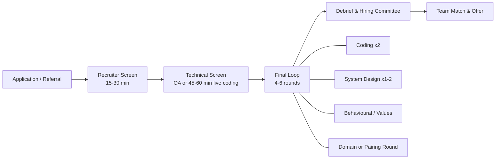

1. **Recruiter screen:** checks motivation, location, salary band and level. Treat it as a real interview: a vague answer to "why us?" ends many processes here.
2. **Technical screen:** either an online assessment (OA) with two or three auto-graded problems, or a live session in a shared editor. The bar is "would we spend a full loop on this person?"
3. **Final loop:** several independent interviewers each produce a written score. Coding rounds dominate at junior levels; design and behavioural rounds carry more weight from senior upwards.
4. **Debrief:** interviewers compare evidence, not impressions. A single "strong no hire" with concrete evidence can outweigh several weak yeses, which is why consistency across rounds matters more than one brilliant round.
5. **Team match and offer:** some companies hire into a pool first and match teams afterwards; others hire for a specific team from the start.

Variations you will meet: pair-programming rounds on a real codebase, take-home projects replacing one coding round (Stage 6.3), debugging rounds where you fix a failing service, and "AI-allowed" rounds where you may use a coding assistant but are scored on how you direct, review and verify its output.

### 1.2 What Interviewers Actually Score

Interviewers fill in a rubric. If you know the columns, you know what to make visible.

| Dimension | Strong signal | Weak signal |
| :--- | :--- | :--- |
| **Problem solving** | Clarifies the problem, proposes a brute force, then improves it with a named insight. | Jumps to code, or stalls silently waiting for the "trick". |
| **Coding** | Clean, idiomatic code with sensible names and small helper functions. | Off-by-one bugs, copy-pasted branches, one-letter names everywhere. |
| **Verification** | Traces an example by hand and tests edge cases before declaring "done". | Says "I think it works" and waits for the interviewer to find bugs. |
| **Communication** | Narrates intent, invites input at decision points, takes hints gracefully. | Monologues, argues with hints, or stays silent for minutes. |
| **Complexity analysis** | States time and space for each candidate approach and justifies them. | Guesses Big-O, or cannot explain why the loop is $O(n \log n)$. |

A working solution with poor communication often scores lower than a nearly working solution where the interviewer could follow every step. The score is evidence of how you would work on the team, not a pass/fail on the test cases.

### 1.3 Levels & Expectations by Seniority

The same question is scored differently depending on the level you are interviewing for.

| Level | Coding bar | System design bar | Behavioural focus |
| :--- | :--- | :--- | :--- |
| **Junior / Graduate** | Solves medium problems with some hints; clear code. | Often skipped, or object-oriented design. | Learning speed, collaboration, ownership of tasks. |
| **Mid-level** | Solves mediums independently, attempts hards. | Designs a single service with a database and cache. | Delivering features end to end, handling feedback. |
| **Senior** | Fast, clean mediums; discusses alternatives unprompted. | Drives a multi-component design and deep-dives two areas. | Leading projects, mentoring, resolving conflict. |
| **Staff / Principal** | Still expected to code competently; less weight. | Frames ambiguous problems, weighs organisational cost, plans migrations. | Multi-team influence, technical strategy, raising the bar for others. |

Down-levelling happens when your evidence matches the level below. The most common cause at senior and above is a design round where the candidate waited to be led instead of driving.

### 1.4 Big-O Foundations & Reading Input Limits

Big-O describes how cost grows as input grows, ignoring constants. In interviews you use it for two things: comparing approaches, and working backwards from the input size to the complexity the interviewer expects.

| Constraint on $n$ | Operations budget (~$10^8$/s) | Complexity that fits | Typical technique |
| :--- | :--- | :--- | :--- |
| $n \le 12$ | tiny | $O(n!)$ | Permutations, brute force |
| $n \le 25$ | ~$3 \times 10^7$ | $O(2^n)$ | Subsets, bitmask DP |
| $n \le 500$ | ~$10^8$ | $O(n^3)$ | Floyd-Warshall, interval DP |
| $n \le 5{,}000$ | ~$2.5 \times 10^7$ | $O(n^2)$ | Nested loops, 2D DP |
| $n \le 10^6$ | ~$2 \times 10^7$ | $O(n \log n)$ | Sorting, heaps, binary search |
| $n \le 10^8$ | ~$10^8$ | $O(n)$ | One pass, two pointers, hashing |
| larger | - | $O(\log n)$ or $O(1)$ | Maths, binary search on the answer |

The same problem at two complexities shows why this matters. Detecting a duplicate with nested loops costs $\frac{n(n-1)}{2}$ comparisons; with a set it costs $n$ lookups.

```python
# 1. Quadratic: compare every pair. 10^5 items -> ~5 * 10^9 comparisons.
def has_duplicate_slow(items: list[int]) -> bool:
    for i in range(len(items)):
        for j in range(i + 1, len(items)):
            if items[i] == items[j]:
                return True
    return False


# 2. Linear: trade O(n) memory for O(1) average lookups.
def has_duplicate(items: list[int]) -> bool:
    seen: set[int] = set()
    for item in items:
        if item in seen:
            return True
        seen.add(item)
    return False


# 3. Space-optimal alternative: sort first, O(n log n) time, O(1) extra space
#    if sorting in place is allowed (ask before mutating the input!).
def has_duplicate_sorted(items: list[int]) -> bool:
    items.sort()
    return any(a == b for a, b in zip(items, items[1:]))
```

Always state both **time** and **space**, and mention the space used by recursion (the call stack) and by the output if it is large.

### 1.5 Choosing Your Interview Language

Use the language you write fastest and most correctly. Python is the most common choice for its brevity and batteries-included collections; JavaScript and TypeScript are natural for frontend and full-stack roles; Java, C++, Go and C# are equally accepted. What matters is fluency with the standard library.

| Need | Python | JavaScript / TypeScript | Watch out for |
| :--- | :--- | :--- | :--- |
| Hash map | `dict`, `collections.Counter`, `defaultdict` | `Map` (any key type), plain objects (string keys only) | JS object keys are coerced to strings: `obj[1]` and `obj["1"]` collide. |
| Set | `set` | `Set` | JS `Set` compares arrays by reference, so `new Set([[1,2]]).has([1,2])` is `false`. Encode as `"1,2"`. |
| Queue | `collections.deque` | Array with a moving head index | `Array.prototype.shift()` is $O(n)$ in the worst case. |
| Min-heap | `heapq` (min-heap; negate for max) | None built in: write one (see `practice/js/src/structures.js`) | Interviewers usually accept "assume a heap class" in JS if you state its API. |
| Sorting | `sorted(xs, key=...)` (stable) | `xs.sort((a, b) => a - b)` (stable since ES2019) | JS default sort is lexicographic: `[10, 9, 1].sort()` gives `[1, 10, 9]`. |
| Big integers | Built in | `BigInt` (`10n`) | JS numbers lose integer precision above `Number.MAX_SAFE_INTEGER` ($2^{53}-1$). |
| Recursion depth | Default limit ~1000 frames | Engine-dependent, roughly 10k frames | Convert deep DFS to an explicit stack for $n \ge 10^4$. |

### 1.6 Running the Practice Suite

Every pattern in Stage 3 has a solved, tested implementation in both languages in this repository.

```text
learn-interview-prep/
├── practice/
│   ├── js/
│   │   ├── src/arrays.js          # hashing, two pointers, windows, binary search, intervals, stack
│   │   ├── src/structures.js      # MinHeap, top-k, union-find, trie, LRU cache
│   │   ├── src/search.js          # BFS/DFS, topological sort, backtracking, DP
│   │   └── test/patterns.test.js  # node:test suite
│   └── python/
│       ├── interview_patterns/    # one module per pattern (13 modules)
│       └── tests/test_patterns.py # pytest suite
├── package.json                   # npm test -> node --test
├── pyproject.toml                 # pytest configuration
├── requirements-dev.txt
└── Dockerfile                     # runs both suites in containers
```

```bash
# 1. JavaScript: no dependencies, uses the built-in node:test runner (Node 22+)
npm test

# 2. Python: isolated virtual environment with pytest
python -m venv .venv
source .venv/bin/activate          # Windows: .venv\Scripts\activate
pip install -r requirements-dev.txt
python -m pytest

# 3. Both suites in containers (the JS stage runs during the build)
docker build -t learn-interview-prep .
docker run --rm learn-interview-prep
```

The best way to use the suite: read a pattern in Stage 3, close the file, re-implement one function from memory, and run the tests against your version.

---

## 2. Stage 2: Core Data Structures & Complexity Deep Dive

Patterns are combinations of a handful of data structures. If you know what each structure costs and why, you can derive most solutions instead of memorising them.

### 2.1 Arrays, Strings & Amortised Growth

Arrays give $O(1)$ access by index because elements sit in contiguous memory. Dynamic arrays (Python `list`, JS `Array`, Java `ArrayList`) grow by allocating a larger block and copying when full. Appending is still $O(1)$ **amortised**: if capacity doubles, the total copy work for $n$ appends is $1 + 2 + 4 + \dots + n < 2n$, so the average per append is constant.

```
capacity 4: [a][b][c][d]          append(e) -> full
allocate 8: [a][b][c][d][e][ ][ ][ ]   copy 4, then write e
next 3 appends are free until capacity 8 is reached
```

Costs to remember:

1. **Insert or delete in the middle:** $O(n)$, because later elements shift.
2. **Strings are immutable** in Python, JS and Java. `s += ch` in a loop can cost $O(n^2)$; collect parts in a list and `"".join(parts)` (Python) or `parts.join('')` (JS).
3. **Slicing copies:** `nums[1:]` in Python and `nums.slice(1)` in JS allocate a new array of size $n-1$. Passing indices instead of slices keeps recursive solutions $O(n)$ rather than $O(n^2)$.
4. **Prefix sums** turn repeated range-sum queries into $O(1)$ each after $O(n)$ preprocessing: `sum(i..j) = prefix[j + 1] - prefix[i]`.

```python
# Prefix sums + hash map: count subarrays whose sum equals k (works with negatives,
# which is exactly where a sliding window breaks down).
from collections import defaultdict


def subarray_sum_count(nums: list[int], k: int) -> int:
    counts = defaultdict(int)
    counts[0] = 1          # the empty prefix
    running = total = 0
    for n in nums:
        running += n
        total += counts[running - k]   # earlier prefixes that leave exactly k
        counts[running] += 1
    return total


assert subarray_sum_count([1, 1, 1], 2) == 2
assert subarray_sum_count([3, -1, -2, 3], 0) == 2
```

### 2.2 Hash Maps & Sets

A hash map turns a key into an integer with a hash function, maps that integer to a bucket, and stores the entry there. Average lookup, insert and delete are $O(1)$. The worst case is $O(n)$ when many keys collide, which is why production languages randomise string hashing (Python does this per process) to resist crafted collision attacks.

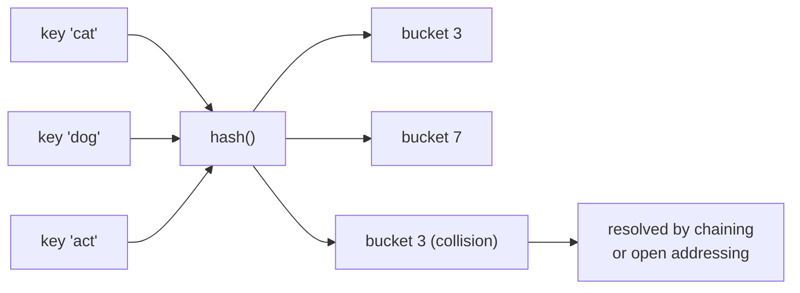

Interview-relevant facts:

1. **Keys must be hashable and stable.** In Python use tuples, not lists, as keys. In JS, `Map` keys compare by identity for objects, so use a string key such as `` `${r},${c}` `` or an integer `r * cols + c` for grid cells.
2. **Ordering:** Python `dict` and JS `Map` both preserve insertion order. That property is what makes the compact LRU cache in Stage 3.12 possible.
3. **Counting:** `collections.Counter` and `map.set(k, (map.get(k) ?? 0) + 1)` are the idioms you will write dozens of times.
4. **Space:** a hash map costs several times the memory of an array of the same data. If keys are small integers in a known range, an array of counts is faster and smaller (for example a 26-slot array for lowercase letters).

### 2.3 Stacks, Queues & Deques

A **stack** is last-in, first-out: use it for matching brackets, undo, depth-first traversal and "most recent unresolved item" problems. A **queue** is first-in, first-out: use it for breadth-first search and scheduling. A **deque** supports both ends in $O(1)$ and powers sliding-window maximum.

```python
from collections import deque

PAIRS = {")": "(", "]": "[", "}": "{"}


def is_valid_brackets(s: str) -> bool:
    stack: list[str] = []
    for ch in s:
        if ch in PAIRS.values():
            stack.append(ch)
        elif ch in PAIRS:
            if not stack or stack.pop() != PAIRS[ch]:
                return False
    return not stack


def sliding_window_max(nums: list[int], k: int) -> list[int]:
    """Deque holds indices whose values are decreasing; the front is the max."""
    window: deque[int] = deque()
    out: list[int] = []
    for i, n in enumerate(nums):
        while window and nums[window[-1]] <= n:
            window.pop()                 # smaller values can never be the max again
        window.append(i)
        if window[0] <= i - k:
            window.popleft()             # front fell out of the window
        if i >= k - 1:
            out.append(nums[window[0]])
    return out


assert is_valid_brackets("([]{})") and not is_valid_brackets("(]")
assert sliding_window_max([1, 3, -1, -3, 5, 3, 6, 7], 3) == [3, 3, 5, 5, 6, 7]
```

### 2.4 Linked Lists & Fast/Slow Pointers

Linked-list questions test pointer manipulation more than algorithms. Draw the boxes and arrows before writing code, and use a **dummy head** node to remove special cases at the front of the list.

```
reverse:   1 -> 2 -> 3 -> null
step:      prev=null, cur=1   save next=2, point 1 -> null, prev=1, cur=2
result:    null <- 1 <- 2 <- 3   (return prev)
```

```javascript
// Linked-list toolkit: reverse, find the middle, detect a cycle (Floyd).
class ListNode {
  constructor(val, next = null) {
    this.val = val;
    this.next = next;
  }
}

function reverse(head) {
  let prev = null;
  let cur = head;
  while (cur) {
    const next = cur.next; // 1. save the rest of the list
    cur.next = prev;       // 2. flip the pointer
    prev = cur;            // 3. advance both
    cur = next;
  }
  return prev;
}

function middle(head) {
  let slow = head;
  let fast = head;
  while (fast && fast.next) {
    slow = slow.next;
    fast = fast.next.next;
  }
  return slow; // second middle for even lengths
}

function hasCycle(head) {
  let slow = head;
  let fast = head;
  while (fast && fast.next) {
    slow = slow.next;
    fast = fast.next.next;
    if (slow === fast) return true; // fast laps slow inside the cycle
  }
  return false;
}

const list = new ListNode(1, new ListNode(2, new ListNode(3)));
console.log(middle(list).val, reverse(list).val, hasCycle(list)); // 2 3 false
```

### 2.5 Trees & Binary Search Trees

Trees are recursive structures, so most tree solutions are a function that returns something about a subtree and combines the results of its children. Decide first what each call **returns** (height? validity? a pair of values?) and the code follows.

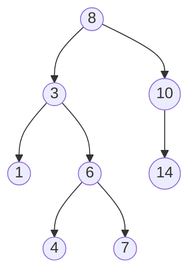

Traversal orders for the BST above: **in-order** (left, node, right) gives `1 3 4 6 7 8 10 14`, which is sorted for any valid BST; **pre-order** gives `8 3 1 6 4 7 10 14`; **level-order** (BFS) gives `8 | 3 10 | 1 6 14 | 4 7`.

```python
from collections import deque
from dataclasses import dataclass


@dataclass
class TreeNode:
    val: int
    left: "TreeNode | None" = None
    right: "TreeNode | None" = None


def max_depth(node: TreeNode | None) -> int:
    if node is None:
        return 0
    return 1 + max(max_depth(node.left), max_depth(node.right))


def is_valid_bst(node: TreeNode | None, low=float("-inf"), high=float("inf")) -> bool:
    # Pass bounds down: checking only node.left.val < node.val misses deeper violations.
    if node is None:
        return True
    if not low < node.val < high:
        return False
    return is_valid_bst(node.left, low, node.val) and is_valid_bst(node.right, node.val, high)


def level_order(root: TreeNode | None) -> list[list[int]]:
    levels: list[list[int]] = []
    queue = deque([root] if root else [])
    while queue:
        levels.append([])
        for _ in range(len(queue)):        # process exactly one level
            node = queue.popleft()
            levels[-1].append(node.val)
            queue.extend(child for child in (node.left, node.right) if child)
    return levels


root = TreeNode(8, TreeNode(3, TreeNode(1), TreeNode(6)), TreeNode(10))
assert max_depth(root) == 3 and is_valid_bst(root)
assert level_order(root) == [[8], [3, 10], [1, 6]]
```

A balanced BST gives $O(\log n)$ search, insert and delete; a degenerate one (inserting sorted data) becomes a linked list with $O(n)$ operations. That is why real libraries use self-balancing trees (red-black, AVL, B-trees).

### 2.6 Heaps & Priority Queues

A binary heap is a complete binary tree stored in an array where every parent is smaller than its children (min-heap). The minimum is at index 0. For index `i`, the children are at `2i + 1` and `2i + 2` and the parent at `(i - 1) // 2`.

```
array:  [1, 3, 2, 7, 4, 5]
tree:          1
             /   \
            3     2
           / \   /
          7   4 5
push: append at the end, swap upwards while smaller than parent    O(log n)
pop:  move last to the root, swap downwards with the smaller child O(log n)
heapify an existing array bottom-up                                O(n)
```

| Operation | Cost | Python `heapq` | JS (this repo's `MinHeap`) |
| :--- | :--- | :--- | :--- |
| Peek min | $O(1)$ | `heap[0]` | `heap.peek()` |
| Push | $O(\log n)$ | `heappush(heap, x)` | `heap.push(x)` |
| Pop min | $O(\log n)$ | `heappop(heap)` | `heap.pop()` |
| Build | $O(n)$ | `heapify(list)` | push each, $O(n \log n)$ |
| Max-heap | - | push `-x`, or tuples `(-priority, item)` | pass a comparator `(a, b) => a > b` |

### 2.7 Graph Representations

Graphs model networks, dependencies, grids and state spaces. Pick the representation from the density and the operations the problem needs.

| Representation | Space | Edge check | Iterate neighbours | Use when |
| :--- | :--- | :--- | :--- | :--- |
| Adjacency list | $O(V + E)$ | $O(\deg v)$ | $O(\deg v)$ | Default for sparse graphs (almost every interview). |
| Adjacency matrix | $O(V^2)$ | $O(1)$ | $O(V)$ | Dense graphs, small $V$, Floyd-Warshall. |
| Edge list | $O(E)$ | $O(E)$ | $O(E)$ | Kruskal's MST, union-find problems. |
| Implicit (grid) | $O(1)$ extra | computed | 4 or 8 directions | Mazes, islands, flood fill. |

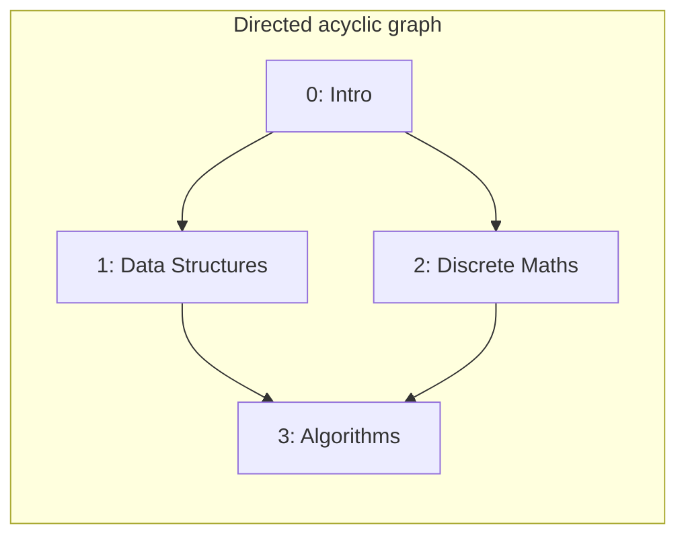

The DAG above is exactly the input to `course_order(4, [[1, 0], [2, 0], [3, 1], [3, 2]])` in `practice/python/interview_patterns/graphs.py`.

### 2.8 Operation Cost Reference

| Structure | Access | Search | Insert | Delete | Notes |
| :--- | :--- | :--- | :--- | :--- | :--- |
| Dynamic array | $O(1)$ | $O(n)$ | $O(1)$ amortised at end, $O(n)$ middle | $O(n)$ | Cache friendly. |
| Sorted array | $O(1)$ | $O(\log n)$ | $O(n)$ | $O(n)$ | Binary search. |
| Hash map / set | - | $O(1)$ avg | $O(1)$ avg | $O(1)$ avg | $O(n)$ worst case. |
| Linked list | $O(n)$ | $O(n)$ | $O(1)$ with node | $O(1)$ with node | Used inside LRU caches. |
| Balanced BST | $O(\log n)$ | $O(\log n)$ | $O(\log n)$ | $O(\log n)$ | Ordered iteration, floor/ceiling. |
| Binary heap | min only $O(1)$ | $O(n)$ | $O(\log n)$ | $O(\log n)$ pop | Top-k, scheduling. |
| Trie | - | $O(L)$ | $O(L)$ | $O(L)$ | $L$ = key length. |
| Union-find | - | $O(\alpha(n))$ | - | - | $\alpha$ grows so slowly it is effectively constant. |

---

## 3. Stage 3: The Coding Patterns Masterclass

There are thousands of practice problems and roughly a dozen ideas behind them. This stage teaches each idea once, with a template and two or three solved problems. Every function named here exists in `practice/` with tests.

### 3.1 Recognising Patterns from Problem Signals

Read the problem for signals before thinking about code.

| Signal in the problem | Likely pattern | Repo function |
| :--- | :--- | :--- |
| "Find a pair / complement / seen before" | Hash map | `two_sum`, `twoSum` |
| Sorted input, pairs or triplets | Two pointers | `three_sum`, `threeSum` |
| "Longest / shortest contiguous subarray or substring" | Sliding window | `min_window`, `minWindow` |
| Sorted data, or "minimum value such that..." | Binary search (on index or answer) | `min_ship_capacity` |
| Ranges, meetings, bookings | Sort by start, sweep | `merge_intervals`, `minMeetingRooms` |
| "Next greater / warmer / taller" | Monotonic stack | `daily_temperatures` |
| "Top k", "k-th largest", merge sorted streams | Heap | `kth_largest`, `mergeKSorted` |
| Grid, network, "minimum steps" | BFS / DFS | `num_islands`, `shortest_path_grid` |
| Dependencies, ordering, "can all tasks finish" | Topological sort | `course_order`, `courseOrder` |
| "All combinations / permutations / subsets" | Backtracking | `subsets`, `permutations` |
| "Number of ways", "minimum cost", overlapping choices | Dynamic programming | `coin_change`, `climbStairs` |
| "Are these connected", merging groups | Union-find | `count_components` |
| Prefix lookups, autocomplete | Trie | `Trie.words_with_prefix` |

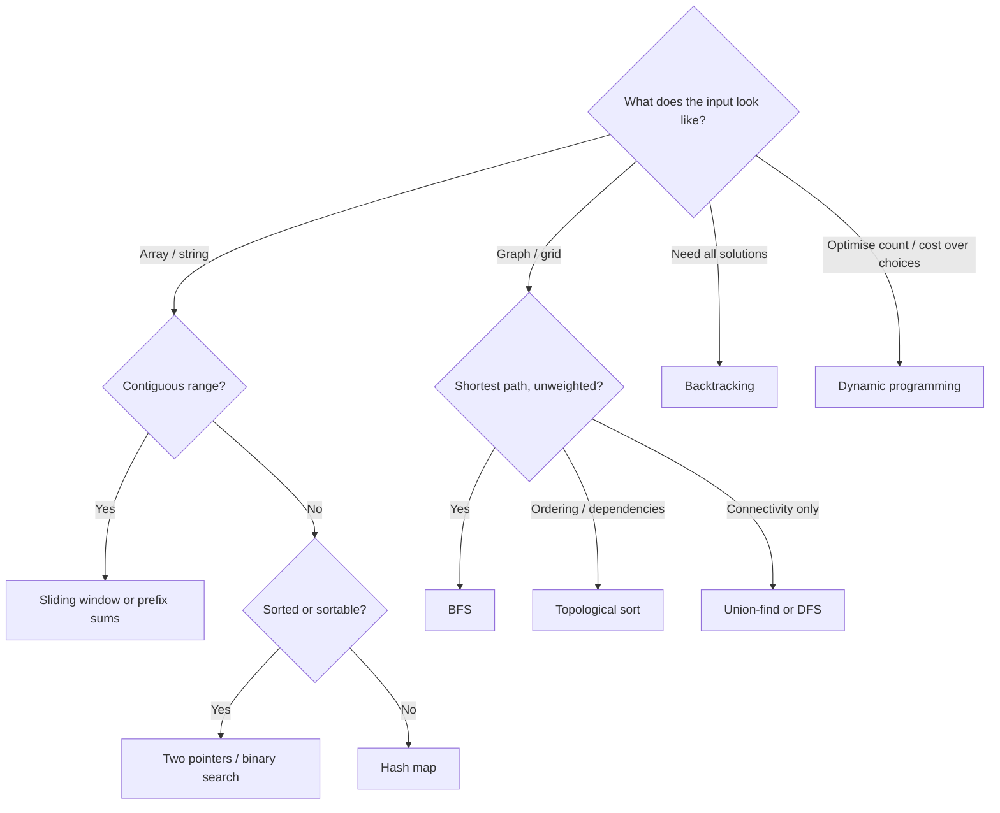

### 3.2 Hashing & Frequency Counting

**Idea:** spend memory to remember what you have seen, so each later question is $O(1)$. The classic move is to look up the **complement** of the current item instead of searching for a pair.

```python
# practice/python/interview_patterns/hashing.py
def two_sum(nums: list[int], target: int) -> tuple[int, int] | None:
    seen: dict[int, int] = {}
    for i, value in enumerate(nums):
        need = target - value
        if need in seen:              # check BEFORE inserting: handles [3, 3], target 6
            return seen[need], i
        seen[value] = i
    return None
```

Variants: group anagrams by a canonical key (`"".join(sorted(word))`, or a 26-count tuple for $O(k)$ keys), first unique character (two passes over a count map), subarray sum equals k (prefix sums in a map, Stage 2.1), longest consecutive sequence (a set plus "only start counting at sequence starts").

### 3.3 Two Pointers

**Idea:** on sorted data, two indices moving towards each other can discard a whole row of candidates per step. If the sum is too small, the left element cannot pair with anything to make the target, so move left; if too big, move right.

```javascript
// practice/js/src/arrays.js
export function threeSum(input) {
  const nums = [...input].sort((a, b) => a - b); // numeric sort, no mutation of input
  const result = [];
  for (let i = 0; i < nums.length - 2; i++) {
    if (nums[i] > 0) break;                          // smallest is positive: no zero sum left
    if (i > 0 && nums[i] === nums[i - 1]) continue;  // skip duplicate anchors
    let left = i + 1;
    let right = nums.length - 1;
    while (left < right) {
      const total = nums[i] + nums[left] + nums[right];
      if (total < 0) left++;
      else if (total > 0) right--;
      else {
        result.push([nums[i], nums[left], nums[right]]);
        left++;
        right--;
        while (left < right && nums[left] === nums[left - 1]) left++; // skip duplicate pairs
      }
    }
  }
  return result;
}
```

Other shapes of the same pattern: **same-direction** pointers (remove duplicates in place, partition), **fast/slow** pointers (cycle detection, Stage 2.4), and **container with most water** where you always move the shorter wall (`max_water_container`).

### 3.4 Sliding Window

**Idea:** for contiguous ranges, keep a window `[left, right]` and its summary (sum, counts, distinct characters). Expand `right` every step; shrink `left` only while the window breaks (or satisfies) the constraint. Each index enters and leaves once, so the total is $O(n)$.

```
s = "ADOBECODEBANC", t = "ABC"
[ADOBEC]ODEBANC      first valid window (A, B, C), length 6
 ADOBE[CODEBA]NC     after shrinking and expanding to the next A, length 6
 ADOBECODE[BANC]     valid, length 4 -> best
```

```python
# practice/python/interview_patterns/sliding_window.py (template annotated)
from collections import Counter


def min_window(s: str, t: str) -> str:
    if not t:
        return ""
    need = Counter(t)        # how many of each char the window still owes
    missing = len(t)         # total chars still owed
    left = 0
    best_start, best_len = 0, len(s) + 1
    for right, ch in enumerate(s):
        if need[ch] > 0:     # 1. expand: this char pays off a debt
            missing -= 1
        need[ch] -= 1
        while missing == 0:  # 2. window valid: record, then shrink
            if right - left + 1 < best_len:
                best_start, best_len = left, right - left + 1
            need[s[left]] += 1
            if need[s[left]] > 0:
                missing += 1
            left += 1
    return "" if best_len > len(s) else s[best_start:best_start + best_len]
```

**When sliding windows fail:** if values can be negative, adding an element does not monotonically increase the sum, so you cannot know when to shrink. Switch to prefix sums with a hash map.

### 3.5 Binary Search & Search on the Answer

**Idea:** whenever a yes/no predicate flips exactly once over an ordered space, binary search finds the flip point in $O(\log n)$ checks. The space can be array indices **or the range of possible answers**.

Use one template and stop worrying about off-by-one errors: probe indices in the half-open range `[lo, hi)` for the first position where the predicate is true. Starting with `hi = len(nums)` means the answer itself can be `len(nums)` ("no element qualifies"), which is why the comment below says the answer lies in the closed range `[lo, hi]`.

```python
# practice/python/interview_patterns/binary_search.py
def lower_bound(nums: list[int], target: int) -> int:
    lo, hi = 0, len(nums)            # answer is in [lo, hi]
    while lo < hi:
        mid = (lo + hi) // 2
        if nums[mid] < target:       # predicate false: answer is right of mid
            lo = mid + 1
        else:                        # predicate true: mid might be the answer
            hi = mid
    return lo


def min_ship_capacity(weights: list[int], days: int) -> int:
    def fits(capacity: int) -> bool:
        used_days, load = 1, 0
        for w in weights:
            if load + w > capacity:
                used_days += 1
                load = 0
            load += w
        return used_days <= days

    lo, hi = max(weights), sum(weights)   # smallest and largest sensible capacities
    while lo < hi:
        mid = (lo + hi) // 2
        if fits(mid):
            hi = mid
        else:
            lo = mid + 1
    return lo
```

"Search on the answer" covers a whole family: minimum eating speed, split array largest sum, minimum days to make bouquets, smallest divisor under a threshold. The total cost is $O(n \log R)$ where $R$ is the answer range. In JavaScript, compute the midpoint with `(lo + hi) >>> 1`; in languages with fixed-width integers, `lo + (hi - lo) / 2` avoids overflow.

### 3.6 Intervals & Sweep Line

**Idea:** sort by start time, then walk once, comparing each interval with the last one you kept. For "how many overlap at once", turn intervals into +1/-1 events and sweep.

```javascript
// practice/js/src/arrays.js
export function mergeIntervals(intervals) {
  const sorted = intervals.map(([s, e]) => [s, e]).sort((a, b) => a[0] - b[0]);
  const merged = [];
  for (const [start, end] of sorted) {
    const last = merged.at(-1);
    if (last && start <= last[1]) last[1] = Math.max(last[1], end); // overlap: extend
    else merged.push([start, end]);
  }
  return merged;
}

export function minMeetingRooms(intervals) {
  const events = [];
  for (const [s, e] of intervals) events.push([s, 1], [e, -1]);
  // At equal times, process ends (-1) before starts (+1): [1,5] and [5,10] share a room.
  events.sort((a, b) => a[0] - b[0] || a[1] - b[1]);
  let rooms = 0;
  let peak = 0;
  for (const [, delta] of events) {
    rooms += delta;
    peak = Math.max(peak, rooms);
  }
  return peak;
}
```

The Python version of `min_meeting_rooms` uses a min-heap of end times instead; both are $O(n \log n)$, and showing you know both is a good way to demonstrate depth.

### 3.7 Monotonic Stack

**Idea:** keep a stack whose values are always increasing (or decreasing). When a new element breaks the order, everything it pops has just found its "next greater" (or smaller) element. Each index is pushed and popped once: $O(n)$.

```
temps:  73  74  75  71  69  72  76  73
i=5 (72): stack holds [75, 71, 69] -> pop 69 (wait 1), pop 71 (wait 2), push 72
i=6 (76): pop 72 (wait 1), pop 75 (wait 4), push 76
answer: [1, 1, 4, 2, 1, 1, 0, 0]
```

```python
# practice/python/interview_patterns/monotonic_stack.py
def largest_rectangle(heights: list[int]) -> int:
    bars = heights + [0]          # sentinel forces every bar to be popped at the end
    stack: list[int] = []         # indices of bars with increasing heights
    best = 0
    for i, h in enumerate(bars):
        while stack and bars[stack[-1]] >= h:
            height = bars[stack.pop()]
            left = stack[-1] + 1 if stack else 0   # bar extends back to after the new top
            best = max(best, height * (i - left))
        stack.append(i)
    return best
```

### 3.8 Heaps & Top-K

**Idea:** to keep the $k$ largest items from a stream, hold a **min-heap of size k** and evict the smallest when it overflows. The root is then the k-th largest. Cost $O(n \log k)$ time, $O(k)$ space, which beats sorting when $k \ll n$ and works on unbounded streams.

```python
# practice/python/interview_patterns/heaps.py
import heapq


def merge_k_sorted(lists: list[list[int]]) -> list[int]:
    # (value, list index, element index): the list index breaks ties so tuples never
    # compare the payload, which matters when payloads are not comparable objects.
    heap = [(lst[0], i, 0) for i, lst in enumerate(lists) if lst]
    heapq.heapify(heap)
    out: list[int] = []
    while heap:
        value, i, j = heapq.heappop(heap)
        out.append(value)
        if j + 1 < len(lists[i]):
            heapq.heappush(heap, (lists[i][j + 1], i, j + 1))
    return out
```

Alternatives worth naming: **bucket sort** by frequency gives $O(n)$ top-k frequent (`topKFrequent` in the JS suite), and **quickselect** finds the k-th element in $O(n)$ average time. Two heaps (a max-heap of the lower half and a min-heap of the upper half) maintain a running median.

### 3.9 Graph Traversal & Topological Sort

**Idea:** BFS explores in rings of equal distance, so the first time it reaches a node is along a shortest path in an unweighted graph. DFS goes deep first and suits connectivity, cycle detection and path enumeration. **Mark nodes visited when you enqueue them**, not when you dequeue them, or the same node enters the queue many times.

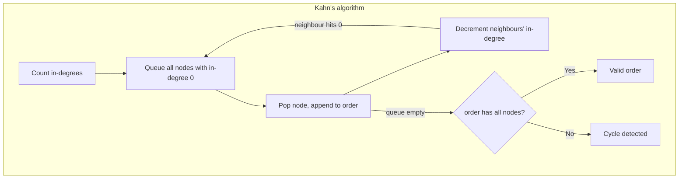

```javascript
// practice/js/src/search.js
export function courseOrder(numCourses, prerequisites) {
  const graph = Array.from({ length: numCourses }, () => []);
  const indegree = new Array(numCourses).fill(0);
  for (const [course, prereq] of prerequisites) {
    graph[prereq].push(course);
    indegree[course]++;
  }
  const queue = [];
  indegree.forEach((d, i) => d === 0 && queue.push(i));
  const order = [];
  for (let head = 0; head < queue.length; head++) { // index-based queue: O(1) dequeue
    const node = queue[head];
    order.push(node);
    for (const next of graph[node]) {
      if (--indegree[next] === 0) queue.push(next);
    }
  }
  return order.length === numCourses ? order : [];
}
```

For **weighted** shortest paths, swap the queue for a min-heap keyed on distance (Dijkstra, $O((V + E) \log V)$, non-negative weights only). For grids, `shortest_path_grid` in the Python suite shows BFS carrying the distance inside each queue entry.

### 3.10 Backtracking

**Idea:** build a solution one choice at a time; after exploring a choice, undo it and try the next. The recursion tree has one level per decision.

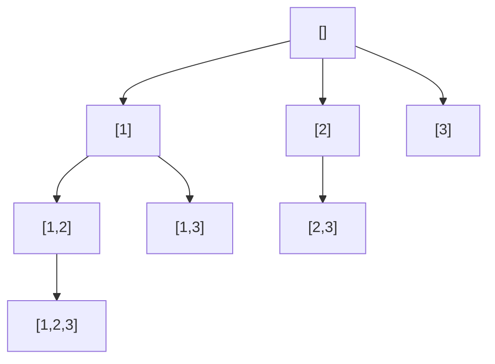

The tree above is `subsets([1, 2, 3])`: every node is recorded, giving $2^3 = 8$ results. The `start` index prevents `[2, 1]` from appearing as a duplicate of `[1, 2]`.

```python
# practice/python/interview_patterns/backtracking.py
def combination_sum(candidates: list[int], target: int) -> list[list[int]]:
    candidates = sorted(candidates)
    result: list[list[int]] = []
    path: list[int] = []

    def explore(start: int, remaining: int) -> None:
        if remaining == 0:
            result.append(path[:])          # copy: path keeps mutating
            return
        for i in range(start, len(candidates)):
            if candidates[i] > remaining:
                break                       # prune: sorted, so the rest are too big
            path.append(candidates[i])      # choose
            explore(i, remaining - candidates[i])   # explore (i, not i+1: reuse allowed)
            path.pop()                      # un-choose

    explore(0, target)
    return result
```

Complexity is exponential by nature; state it honestly (subsets $O(n \cdot 2^n)$, permutations $O(n \cdot n!)$) and show where pruning cuts the tree.

### 3.11 Dynamic Programming

**Idea:** when a brute-force recursion solves the same subproblem many times, store each answer once. Every DP solution answers four questions:

1. **State:** what does `dp[i]` (or `dp[i][j]`) mean, in one sentence?
2. **Transition:** how is a state computed from smaller states?
3. **Base cases:** which states are known without computation?
4. **Order:** in which order must states be filled so dependencies are ready?

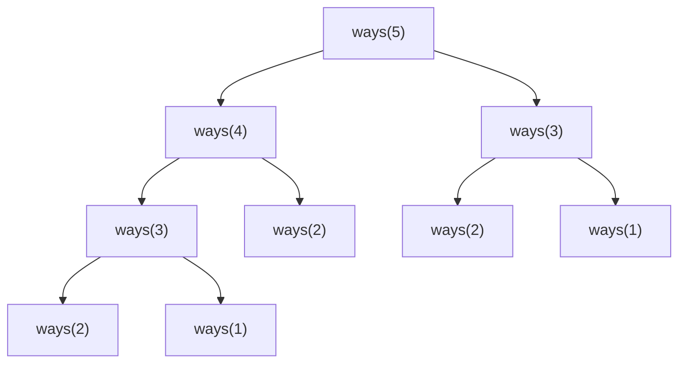

The repeated `ways(3)` and `ways(2)` nodes are why plain recursion is exponential and memoised recursion is linear.

```python
# practice/python/interview_patterns/dynamic_programming.py
def coin_change(coins: list[int], amount: int) -> int:
    # State: dp[a] = fewest coins summing to a. Transition: dp[a] = min(dp[a - c] + 1).
    # Base: dp[0] = 0. Order: increasing a, so dp[a - c] is always ready.
    unreachable = amount + 1
    dp = [0] + [unreachable] * amount
    for a in range(1, amount + 1):
        for coin in coins:
            if coin <= a and dp[a - coin] + 1 < dp[a]:
                dp[a] = dp[a - coin] + 1
    return -1 if dp[amount] == unreachable else dp[amount]


def longest_common_subsequence(a: str, b: str) -> int:
    # State: cur[j] = LCS of a[:i] and b[:j]. Only the previous row is needed,
    # so space drops from O(len(a) * len(b)) to O(len(b)).
    prev = [0] * (len(b) + 1)
    for ch_a in a:
        cur = [0] * (len(b) + 1)
        for j, ch_b in enumerate(b, start=1):
            cur[j] = prev[j - 1] + 1 if ch_a == ch_b else max(prev[j], cur[j - 1])
        prev = cur
    return prev[-1]
```

`coin_change([1, 3, 4], 6)` returns 2 (`3 + 3`), whereas a greedy "largest coin first" picks `4 + 1 + 1`. Use this counter-example whenever an interviewer asks why greedy is not enough. Common DP families: 1D sequences (house robber, climbing stairs), 2D grids (unique paths), two strings (LCS, edit distance), knapsack (subset sum, coin change) and interval DP (burst balloons).

### 3.12 Union-Find, Tries & Design Problems

**Union-find** tracks which elements belong to the same group with near-constant `find` and `union`. Two optimisations make it fast: **union by rank** keeps trees shallow, and **path compression** (here path halving) flattens them during `find`.

```python
# practice/python/interview_patterns/union_find.py (core)
class UnionFind:
    def __init__(self, size: int) -> None:
        self.parent = list(range(size))
        self.rank = [0] * size
        self.components = size

    def find(self, x: int) -> int:
        while self.parent[x] != x:
            self.parent[x] = self.parent[self.parent[x]]   # path halving
            x = self.parent[x]
        return x

    def union(self, a: int, b: int) -> bool:
        ra, rb = self.find(a), self.find(b)
        if ra == rb:
            return False                                   # already connected: a cycle edge
        if self.rank[ra] < self.rank[rb]:
            ra, rb = rb, ra
        self.parent[rb] = ra
        if self.rank[ra] == self.rank[rb]:
            self.rank[ra] += 1
        self.components -= 1
        return True
```

A **trie** stores strings character by character so that every prefix query costs $O(L)$, independent of how many words are stored. It powers autocomplete (`Trie.words_with_prefix`) and word-search problems.

**Design problems** ask you to build a class with stated complexity guarantees. The LRU cache is the most frequent one. Its textbook answer is a hash map plus a doubly linked list; in Python and JavaScript the ordered map does both jobs, which is a perfectly good interview answer as long as you can explain the underlying structure when asked.

```javascript
// practice/js/src/structures.js
export class LRUCache {
  #map = new Map(); // iteration order = least to most recently used

  constructor(capacity) {
    if (!(capacity > 0)) throw new RangeError('capacity must be positive');
    this.capacity = capacity;
  }

  get(key) {
    if (!this.#map.has(key)) return undefined;
    const value = this.#map.get(key);
    this.#map.delete(key); // move to the most-recent end
    this.#map.set(key, value);
    return value;
  }

  put(key, value) {
    this.#map.delete(key);
    this.#map.set(key, value);
    if (this.#map.size > this.capacity) {
      this.#map.delete(this.#map.keys().next().value); // evict the oldest
    }
  }
}
```

---

## 4. Stage 4: Live Coding Execution & Communication

Knowing the pattern is half the round. The other half is executing in front of someone, on a clock, while making your reasoning visible. This stage is a repeatable procedure for that.

### 4.1 A Six-Step Framework for Every Problem

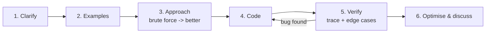

| Step | Minutes (of 45) | What you say and do |
| :--- | :--- | :--- |
| **1. Clarify** | 3-5 | Restate the problem in your own words. Ask about input size, value ranges, duplicates, empty input, and expected output format. |
| **2. Examples** | 2-3 | Write one normal example and one edge case in the editor as comments. Agree on the expected outputs. |
| **3. Approach** | 5-8 | State the brute force and its complexity first. Then name the insight that improves it. Get a nod before coding. |
| **4. Code** | 15-20 | Write top-down: main function first, helpers named and filled in after. Narrate intent, not keystrokes. |
| **5. Verify** | 5 | Trace your example line by line with concrete values. Run the edge cases mentally (or for real if the editor runs code). |
| **6. Optimise** | 3-5 | State final time and space. Mention what you would change for larger inputs, streaming data or concurrency. |

Leave the last five minutes for your questions to the interviewer. If the clock is running out, say so and describe the remaining steps rather than rushing broken code.

### 4.2 Clarifying Questions That Change the Solution

Every question you ask should be able to change your design. Good ones:

1. **Size:** "How large can `n` get?" decides between $O(n^2)$ and $O(n \log n)$ (Stage 1.4).
2. **Order:** "Is the input sorted? Can I sort it?" unlocks two pointers and binary search.
3. **Duplicates:** "Can values repeat? Should the output contain duplicates?" changes `three_sum` substantially.
4. **Range and sign:** "Can numbers be negative or zero?" breaks sliding-window sums (Stage 3.4).
5. **Mutation:** "May I modify the input in place?" decides whether an $O(1)$-space answer is allowed.
6. **Output:** "Return indices or values? Any valid answer or all of them? What if there is none?"
7. **Character set:** "ASCII only or full Unicode?" affects fixed-size count arrays and string iteration (JS strings are UTF-16, so `s.length` counts code units, not characters).

Avoid questions with no design impact ("Which language should I use?" after you have already been told) and do not ask so many that you have not started after ten minutes.

### 4.3 Thinking Out Loud Without Rambling

Narrate **decisions and reasons**, not syntax. Compare:

```text
Weak:   "Okay so I'm going to write a for loop... i equals zero... and then..."
Strong: "I'll scan once and keep a map from value to index, so each complement
         lookup is O(1). I'm checking before inserting so [3, 3] with target 6 works."
```

Useful phrases at each checkpoint:

1. **Before coding:** "The brute force is $O(n^2)$ because we compare every pair. Since we only need to know whether a complement exists, a hash map makes each check constant. Shall I go with that?"
2. **When stuck:** "I'm deciding between a heap and sorting. Sorting is simpler but $O(n \log n)$ for all elements; a heap of size k is $O(n \log k)$. Given k is small, I'll use the heap."
3. **Taking a hint:** "That's a good point: if the array is sorted I don't need the map. Let me switch to two pointers." Hints are part of the score; accepting them quickly is a positive signal.
4. **After coding:** "Let me trace `[2, 7, 11, 15]` with target 9 before calling this done."

### 4.4 Dry Runs & Self-Testing

Catching your own bug scores far better than having the interviewer catch it. Trace with a table of variables, one row per iteration:

```text
longest_unique_substring("abba")
i  ch  last_seen before      start  window   best
0  a   {}                    0      "a"      1
1  b   {a:0}                 0      "ab"     2
2  b   {a:0, b:1}            2      "b"      2
3  a   {a:0, b:2}            2      "ba"     2    <- a was seen at 0 < start: do NOT move start back
```

That last row is the classic bug: without the `last_seen[ch] >= start` guard, `start` jumps backwards to 1 and the answer becomes 3. The repo test `("abba", 2)` exists for exactly this reason.

Edge-case checklist to run through before saying "done":

- Empty input, single element, two elements.
- All elements equal; already sorted; reverse sorted.
- Negative numbers, zero, very large values (overflow in fixed-width languages).
- Target not present; multiple valid answers.
- For graphs: disconnected components, self-loops, cycles.

### 4.5 Debugging & Recovering Under Pressure

When the output is wrong:

1. **Reproduce with the smallest failing input.** Shrink the example until the bug still shows.
2. **Check the invariant.** Say what should be true at the top of each loop iteration ("everything left of `left` is less than the target") and find the first iteration where it is false.
3. **Suspect the usual culprits:** off-by-one loop bounds, `<` versus `<=` in binary search, forgetting to copy a list before appending it to the results in backtracking, mutating a collection while iterating it, and integer division (`//` in Python, `Math.floor` or `>>> 1` in JS).
4. **Use prints deliberately** if the environment runs code: print the state at one point, not everywhere.

If you go blank, fall back to the brute force and say so: "Let me get a correct $O(n^2)$ version working first, then optimise." A working brute force with a clear explanation of the better approach usually earns a passing score; an unfinished optimal attempt often does not.

### 4.6 Online Assessments & Timed Platforms

Online assessments (OAs) are auto-graded, usually 60-90 minutes for two to four problems, with hidden test cases that probe performance and edge cases.

1. **Read all problems first** and solve the easiest one first to bank points.
2. **Partial credit is common:** many platforms score per test case, so a correct brute force that passes the small tests is worth submitting before you optimise.
3. **Read input limits** to detect when a brute force will time out (Stage 1.4).
4. **Know your language's I/O:** in Python, reading large input with `sys.stdin` is much faster than repeated `input()`; in Node, read all of stdin at once.
5. **Practise in the platform's editor** beforehand, without autocomplete if that is how the real test runs.
6. **Proctoring rules:** follow them exactly. Most OAs forbid outside help, and plagiarism detection compares submissions across candidates.

```python
# Fast input template for OA platforms that pipe test data through stdin.
import sys


def main() -> None:
    data = sys.stdin.buffer.read().split()
    n = int(data[0])
    nums = list(map(int, data[1 : 1 + n]))
    target = int(data[1 + n])
    seen: dict[int, int] = {}
    for i, value in enumerate(nums):
        if target - value in seen:
            print(seen[target - value], i)
            return
        seen[value] = i
    print(-1)


if __name__ == "__main__":
    main()
```

### 4.7 Deliberate Practice & Spaced Repetition

Solving 500 problems once is less effective than solving 150 problems three times. Track every problem with the pattern, whether you solved it unaided, and when to retry it. The small scheduler below doubles the interval after each clean solve and resets it after a failure.

```python
# Tiny spaced-repetition scheduler for practice problems.
from dataclasses import dataclass, field
from datetime import date, timedelta


@dataclass
class Card:
    problem: str
    pattern: str
    interval_days: int = 1
    due: date = field(default_factory=date.today)

    def review(self, solved_unaided: bool, today: date | None = None) -> None:
        today = today or date.today()
        self.interval_days = min(self.interval_days * 2, 60) if solved_unaided else 1
        self.due = today + timedelta(days=self.interval_days)


def due_today(cards: list[Card], today: date | None = None) -> list[Card]:
    today = today or date.today()
    return sorted((c for c in cards if c.due <= today), key=lambda c: c.pattern)


deck = [Card("min_window", "sliding window"), Card("course_order", "topological sort")]
start = date(2026, 11, 2)
deck[0].review(solved_unaided=True, today=start)    # next review in 2 days
deck[1].review(solved_unaided=False, today=start)   # retry tomorrow
assert [c.problem for c in due_today(deck, start + timedelta(days=1))] == ["course_order"]
```

Rules that make practice transfer to interviews:

1. **Time-box:** 25 minutes for a medium before reading a hint, 45 before reading the solution.
2. **After reading a solution,** close it and re-implement from scratch the next day.
3. **Practise aloud** at least twice a week, ideally in mock interviews with a peer who scores you against the rubric in Stage 1.2.
4. **Review by pattern, not by problem:** when you fail, write down which signal you missed.

---

## 5. Stage 5: System Design Interviews from Requirements to Trade-offs

System design rounds are open-ended on purpose. There is no single right answer; there are well-reasoned and poorly reasoned ones. You are scored on how you scope the problem, quantify it, choose components, and defend trade-offs.

### 5.1 The Design Interview Framework

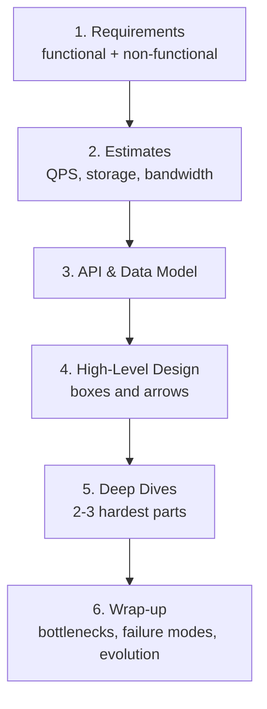

| Phase | Minutes (of 45-60) | Output |
| :--- | :--- | :--- |
| Requirements | 5-8 | A short list of must-have features, explicit non-goals, and targets for latency, availability, consistency and scale. |
| Estimates | 3-5 | Read and write QPS, peak factor, storage per year, bandwidth. Only as precise as needed to choose components. |
| API & data model | 5-8 | Endpoints or RPCs with request and response shapes; core tables or documents and their keys. |
| High-level design | 10 | Clients, load balancer, services, data stores, caches, queues. Walk one request through it. |
| Deep dives | 15-20 | The parts the interviewer cares about: hot keys, consistency, fan-out, failure handling. |
| Wrap-up | 3-5 | Single points of failure, monitoring, what changes at 10x scale. |

Drive the conversation. Check in at each phase transition ("I'll assume reads dominate 100:1; does that match what you had in mind?"), but do not wait to be told what to do next.

### 5.2 Back-of-the-Envelope Estimation

Estimates exist to make decisions: does it fit on one machine, does it need a cache, does it need sharding? Round aggressively and use powers of ten.

| Quantity | Handy value |
| :--- | :--- |
| Seconds per day | $86{,}400 \approx 10^5$ |
| 1 million requests/day | ~12 requests/second average |
| Peak-to-average factor | 2-5x for consumer traffic |
| Memory reference | ~100 nanoseconds |
| SSD random read | tens of microseconds |
| Round trip within a data centre | ~0.5 milliseconds |
| Round trip across continents | ~100-150 milliseconds |
| One commodity server | thousands to tens of thousands of simple requests/second |

**Worked example:** a photo-sharing service with 50 million daily active users, each viewing 20 photos and uploading 0.1 photos per day, average photo 500 KB.

- Reads: $50 \times 10^6 \times 20 = 10^9$ per day $\approx 10^9 / 10^5 = 10^4$ reads/second, about $3 \times 10^4$ at peak.
- Writes: $50 \times 10^6 \times 0.1 = 5 \times 10^6$ per day $\approx 50$ uploads/second.
- Storage: $5 \times 10^6 \times 500\,\text{KB} = 2.5\,\text{TB}$ per day, roughly $0.9\,\text{PB}$ per year before replication.
- Conclusions: reads outnumber writes 200:1, so cache aggressively and serve images from a CDN; blob storage, not a database, holds the image bytes; metadata is small and fits a replicated relational database for a long time.

### 5.3 Core Building Blocks

| Component | What it gives you | Key trade-off to mention |
| :--- | :--- | :--- |
| **Load balancer** (L4/L7) | Spreads traffic, removes unhealthy instances, terminates TLS. | L7 can route on paths and headers but costs more CPU; sticky sessions hurt even distribution. |
| **Stateless app tier** | Horizontal scaling by adding instances. | Session state must live elsewhere (cookie, token, cache). |
| **Relational database** | Transactions, joins, constraints, mature tooling. | Vertical scaling limit; sharding is operationally expensive. |
| **Key-value / wide-column store** | Predictable low latency at huge scale, easy partitioning. | Limited queries; you model data around access patterns. |
| **Cache** (in-process, Redis, Memcached) | Cuts read latency and database load. | Staleness, invalidation, thundering herds on expiry. |
| **Message queue / log** (e.g. Kafka, SQS, RabbitMQ) | Decouples producers and consumers, absorbs spikes, enables retries. | Eventual consistency, ordering only within a partition, duplicate delivery. |
| **Blob storage** (S3-compatible) | Cheap, durable storage for large files. | Higher latency; pair with a CDN for reads. |
| **CDN** | Serves static and cacheable content close to users. | Invalidation delay; cost per GB. |
| **Search index** | Full-text and faceted queries. | A second copy of data that must be kept in sync. |

Caching strategies to name precisely: **cache-aside** (app reads cache, falls back to DB, then populates), **write-through** (write to cache and DB together), **write-behind** (write to cache, flush to DB asynchronously, which risks data loss), plus TTLs and explicit invalidation on writes.

### 5.4 Replication, Partitioning & Consistency

**Replication** copies data for availability and read throughput. Leader-follower is the common default: writes go to the leader, reads can go to followers, and followers may lag, so a user might not see their own write. Fix that with read-your-writes routing (send a user's reads to the leader for a short time after they write).

**Partitioning (sharding)** splits data across machines for write throughput and storage. Choose the partition key from the access pattern:

1. **Range partitioning** keeps related keys together and supports range scans, but sequential keys (timestamps) create hot spots.
2. **Hash partitioning** spreads load evenly but loses range queries.
3. **Consistent hashing** places nodes and keys on a ring so that adding or removing a node moves only about $1/N$ of the keys, instead of nearly all of them as with `hash(key) % N`. Virtual nodes smooth out uneven ring segments.

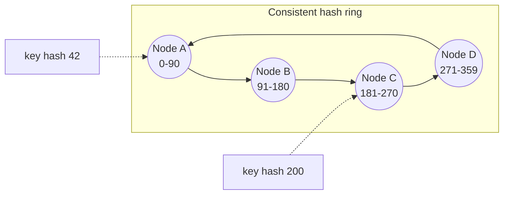

**Consistency vocabulary:** under a network partition a distributed store must choose between consistency and availability (CAP). Even without partitions there is a latency-versus-consistency trade-off (PACELC). In interviews, say which operations need strong consistency (payments, inventory decrements, unique usernames) and which tolerate eventual consistency (like counts, feeds, analytics).

### 5.5 Worked Example: URL Shortener

**Requirements.** Create a short link for a long URL; redirect short to long; optional custom alias and expiry. Non-functional: redirects under 50 ms at p99, very high availability for reads, 100 million new links per month, read-to-write ratio around 100:1.

**Estimates.** $10^8 / (30 \times 10^5) \approx 35$ writes/second, about $3{,}500$ redirects/second average. Five years of links: $6 \times 10^9$ rows at ~500 bytes is ~3 TB. Seven base62 characters give $62^7 \approx 3.5 \times 10^{12}$ codes, far more than needed.

**API.**

```text
POST /api/v1/links        { "url": "https://...", "alias": "optional", "expiresAt": "optional" }
  -> 201 { "code": "aZ3kP9q", "shortUrl": "https://sho.rt/aZ3kP9q" }
GET  /{code}              -> 301/302 Location: <long url>   (404 if unknown, 410 if expired)
```

**Data model.**

```sql
CREATE TABLE links (
    code        VARCHAR(16) PRIMARY KEY,      -- base62 code or custom alias
    long_url    TEXT        NOT NULL,
    owner_id    BIGINT,
    created_at  TIMESTAMPTZ NOT NULL DEFAULT now(),
    expires_at  TIMESTAMPTZ
);
CREATE INDEX links_owner_idx ON links (owner_id, created_at DESC);
```

**Code generation.** Hashing the long URL and truncating risks collisions that need retry loops. A common alternative is a unique 64-bit ID (from a database sequence handed out in blocks, or a Snowflake-style generator) encoded in base62. IDs are unique by construction, so no collision check is required; to avoid guessable sequential codes, shuffle the ID with a reversible permutation before encoding.

```python
# Base62 encoding of numeric IDs, the core of the code generator.
ALPHABET = "0123456789abcdefghijklmnopqrstuvwxyzABCDEFGHIJKLMNOPQRSTUVWXYZ"
BASE = len(ALPHABET)  # 62


def encode(n: int) -> str:
    if n < 0:
        raise ValueError("ids are non-negative")
    if n == 0:
        return ALPHABET[0]
    digits: list[str] = []
    while n:
        n, rem = divmod(n, BASE)
        digits.append(ALPHABET[rem])
    return "".join(reversed(digits))


def decode(code: str) -> int:
    n = 0
    for ch in code:
        n = n * BASE + ALPHABET.index(ch)
    return n


assert decode(encode(3_500_000_000_000)) == 3_500_000_000_000
assert len(encode(62**7 - 1)) == 7
```

**High-level design.**

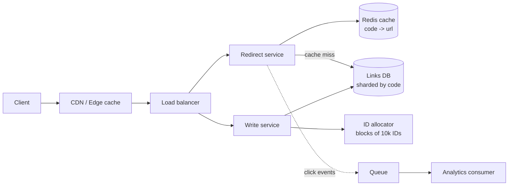

**Deep dives to offer.**

1. **301 versus 302:** a permanent 301 lets browsers cache the redirect, cutting load but hiding repeat clicks from analytics; 302 keeps every click visible.
2. **Hot links:** a viral code can saturate one cache shard; replicate hot keys or cache them at the edge with a short TTL.
3. **Analytics:** never write click counts synchronously in the redirect path. Emit events to a queue and aggregate asynchronously.
4. **Abuse:** rate-limit creation per user and IP, and scan long URLs against malware lists before activation.
5. **Expiry:** check `expires_at` on read, and delete expired rows with a background job.

### 5.6 Worked Example: Distributed Rate Limiter

**Requirements.** Limit each API key to N requests per window across a fleet of API servers, add under a millisecond of latency, and fail in a predictable way if the limiter store is down.

Algorithms to compare:

| Algorithm | Behaviour | Memory per key | Weakness |
| :--- | :--- | :--- | :--- |
| Fixed window counter | Count per calendar window. | 1 counter | Allows up to 2N at window boundaries. |
| Sliding log | Store each request timestamp. | O(N) | Memory-heavy at high limits. |
| Sliding window counter | Weighted blend of current and previous window counts. | 2 counters | Approximate, but close enough in practice. |
| Token bucket | Tokens refill at a rate up to a capacity; each request spends one. | 2 numbers | Needs atomic read-modify-write. |

```javascript
// Token bucket: capacity allows bursts, refillPerSecond sets the sustained rate.
// In production the state lives in a shared store (for example a Redis hash updated
// atomically by a Lua script) so every API server sees the same bucket.
export class TokenBucket {
  constructor({ capacity, refillPerSecond, now = () => Date.now() }) {
    this.capacity = capacity;
    this.refillPerMs = refillPerSecond / 1000;
    this.now = now;
    this.buckets = new Map(); // key -> { tokens, updatedAt }
  }

  tryRemove(key, cost = 1) {
    const t = this.now();
    const bucket = this.buckets.get(key) ?? { tokens: this.capacity, updatedAt: t };
    // 1. Refill based on elapsed time, capped at capacity.
    const elapsed = t - bucket.updatedAt;
    bucket.tokens = Math.min(this.capacity, bucket.tokens + elapsed * this.refillPerMs);
    bucket.updatedAt = t;
    // 2. Spend if possible.
    const allowed = bucket.tokens >= cost;
    if (allowed) bucket.tokens -= cost;
    this.buckets.set(key, bucket);
    // 3. Tell the caller when to retry (seconds) for a Retry-After header.
    const retryAfter = allowed ? 0 : Math.ceil((cost - bucket.tokens) / this.refillPerMs / 1000);
    return { allowed, remaining: Math.floor(bucket.tokens), retryAfter };
  }
}

let fakeTime = 0;
const limiter = new TokenBucket({ capacity: 2, refillPerSecond: 1, now: () => fakeTime });
console.log(limiter.tryRemove('key-1').allowed); // true
console.log(limiter.tryRemove('key-1').allowed); // true
console.log(limiter.tryRemove('key-1'));         // { allowed: false, remaining: 0, retryAfter: 1 }
fakeTime = 1000;
console.log(limiter.tryRemove('key-1').allowed); // true (one token refilled)
```

Points to raise in the deep dive: the read-modify-write must be atomic in the shared store (a Lua script or a transaction), clock differences between servers argue for using the store's time, a local in-memory pre-check can absorb obvious abuse before hitting the network, and you must choose **fail-open** (allow traffic if the limiter is down, protecting availability) or **fail-closed** (reject, protecting the backend) per endpoint. Return `429 Too Many Requests` with `Retry-After` and rate-limit headers.

### 5.7 Trade-off Vocabulary & Red Flags

Strong candidates state trade-offs as "X gives us A at the cost of B, which is acceptable because C."

| Decision | Option A | Option B | Typical deciding factor |
| :--- | :--- | :--- | :--- |
| Consistency | Strong | Eventual | Does a stale read cause money loss or a broken invariant? |
| Fan-out for feeds | On write (push) | On read (pull) | Ratio of followers to posts; celebrities usually need a hybrid. |
| Storage | SQL | NoSQL | Need for transactions and ad-hoc queries versus scale and simple access patterns. |
| Communication | Synchronous RPC | Async messaging | Does the caller need the result now? Can work be retried later? |
| Processing | Batch | Stream | Freshness requirement versus cost and complexity. |
| Delivery | At-least-once + idempotency | Exactly-once claims | Exactly-once end to end is rare; idempotent consumers are the practical answer. |

Red flags interviewers write down: designing before asking requirements, naming technologies without saying why, ignoring failure cases, a single database for everything at planet scale with no discussion, no estimates at all, and refusing to change the design when the interviewer adds a constraint.

---

## 6. Stage 6: Behavioural Mastery, Take-Home Projects & the Study Plan

Behavioural rounds are not a formality. At senior levels and above they often decide the level of the offer. This stage also covers take-home projects, the questions you ask, the offer itself, and the schedule that ties everything together.

### 6.1 The STAR Method & Your Story Bank

Structure every behavioural answer as **Situation, Task, Action, Result**, spending most of the time on Action and finishing with a measurable Result and what you learned.

```text
Situation (15%): "Our checkout service had p99 latency of 2.4 s during sales events."
Task      (10%): "As the on-call lead I owned bringing it under 500 ms before Black Friday."
Action    (55%): "I profiled production traces and found N+1 queries in the pricing
                  call. I proposed batching, wrote the design doc, paired with two
                  engineers on the change, and added a load test to CI so it could
                  not regress. When product wanted to delay for a feature, I showed
                  the revenue at risk from abandoned carts and we agreed on a plan."
Result    (20%): "p99 dropped to 380 ms, checkout conversion rose 3% during the sale,
                  and the load test caught two regressions in the next quarter.
                  I learned to attach a business metric to performance work early."
```

Build a **story bank** of 8-10 stories before interviewing, then map each to the themes below. One strong story usually covers two or three themes.

| Theme | Example prompt | Your story (fill in) |
| :--- | :--- | :--- |
| Ownership | "Tell me about something you owned end to end." | |
| Conflict | "Describe a disagreement with a colleague or manager." | |
| Failure | "Tell me about a mistake and what you changed afterwards." | |
| Ambiguity | "When did you start with unclear requirements?" | |
| Influence | "How did you convince others without authority?" | |
| Delivery under pressure | "Tell me about a tight deadline." | |
| Mentoring | "How have you helped someone grow?" | |
| Customer focus | "When did you push back to protect users?" | |
| Technical depth | "What is the hardest bug you have fixed?" | |
| Prioritisation | "How did you decide what not to do?" | |

Rules: say "I", not "we", when describing your actions; keep each answer to about two minutes and let the interviewer dig in; never criticise former colleagues; for failure stories, pick a real failure with a real lesson, not a disguised strength.

### 6.2 Answering for Seniority: Scope, Ambiguity & Influence

The same story told at different levels emphasises different things.

| Level | Scope of a strong story | Signals to make explicit |
| :--- | :--- | :--- |
| Junior | A task or feature. | Learning quickly, asking for help at the right time, finishing things. |
| Mid | A feature or small project. | Independent delivery, code quality, working across a team. |
| Senior | A project or system spanning teams. | Technical leadership, trade-off decisions, mentoring, handling risk. |
| Staff+ | A problem spanning an organisation, often with no owner. | Finding the problem, setting direction, aligning several teams, long-term outcomes, growing other leaders. |

For staff-level interviews, prepare at least one story each about: setting technical direction that others adopted, a large migration you planned and de-risked, a time you decided **not** to build something, and a time you changed how an organisation works (process, standards, hiring).

### 6.3 Take-Home Projects That Stand Out

Take-homes are scored like a pull request from a new colleague. Reviewers usually spend 15-30 minutes on yours, so make the strengths easy to find.

Checklist:

1. **Respect the time box.** If they say four hours, spend about four hours and say what you would do with more. Over-delivering by a week signals poor prioritisation.
2. **Run in one command.** `npm install && npm test` or `docker compose up` must work on a clean machine. Pin dependency versions.
3. **Tests for the core logic** and the edge cases named in the brief. Not 100% coverage; meaningful coverage.
4. **Clear structure:** separate domain logic from I/O (HTTP handlers, CLI parsing, database access) so it is testable.
5. **Small, descriptive commits** that show your process.
6. **Handle errors and validation** at the boundaries, with useful messages.
7. **A README that answers reviewers' questions** before they ask.

```markdown
# Inventory Service (take-home)

## Run
npm ci && npm test        # unit + integration tests
npm start                 # http://localhost:8080

## What's here
- `src/domain/` pure business rules (reservation, restock), fully unit tested
- `src/http/` thin Express handlers, validated with zod
- `test/` 24 tests, including concurrent reservation of the last item

## Decisions & trade-offs
- In-memory store behind a repository interface; swapping in Postgres needs one class.
- Optimistic concurrency with a version column rather than locks: low contention expected.

## Not done (time box: 4h) and what I would do next
- Persistence, auth, pagination on GET /items
- Load test the reservation endpoint
```

Expect a follow-up session where you extend or defend the project. Re-read your code the day before.

### 6.4 Questions to Ask Your Interviewers

Your questions are scored too, and they are your best source of information about the job. Ask different interviewers different questions.

1. **Engineering:** "How does code get from a laptop to production here, and how long does it take?" "What does on-call look like, and how many pages a week?"
2. **Team:** "What is the team's biggest technical challenge this year?" "How are priorities decided when product and engineering disagree?"
3. **Growth:** "What separates people who do well in this role from those who struggle?" "How are promotions decided?"
4. **Manager:** "How do you give feedback? When did you last change your mind because of an engineer?"
5. **Staff level:** "Which problems currently have no clear owner?" "How are cross-team technical decisions made and recorded?"

Avoid questions answered on the careers page, and save compensation details for the recruiter.

### 6.5 Offers, Levelling & Negotiation

1. **Levelling is decided first** and drives everything else; a level difference is usually worth more than any negotiation within a band. If you believe you were under-levelled, ask what evidence would support the higher level and whether a follow-up round is possible.
2. **Understand the components:** base salary, bonus (target and how it is actually paid out), equity (grant value, vesting schedule, cliff, refreshers; for private companies also the latest valuation and liquidation preferences), sign-on bonus, and benefits.
3. **Avoid naming a number first** when possible. "I'd like to understand the full scope and level first; I'm sure we can find a fair number" is a polite deferral. If pressed, give a researched range anchored on market data for that level and location.
4. **Negotiate with information, not ultimatums.** Competing offers are the strongest lever; a clear, specific ask ("If you can reach X base, I'm ready to sign this week") is more effective than vague dissatisfaction.
5. **Get everything in writing** before resigning from your current role, including start date, remote policy and equity terms.

### 6.6 The 12-Week Structured Study Plan

Assumes about 10 hours a week alongside a full-time job. Compress it to six weeks with 20 hours a week, or extend it if you are starting from scratch. The chart uses an example start date (Monday 2 November 2026); shift the dates to your own start week.

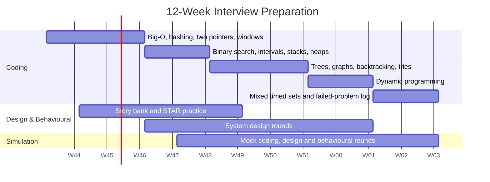

| Week | Coding focus (repo modules) | Design and behavioural | Weekly milestone |
| :--- | :--- | :--- | :--- |
| 1 | Big-O, arrays, `hashing` | Read Stage 1; list target companies and levels | 10 easy problems, all with stated complexity |
| 2 | `two_pointers`, linked lists | Draft 4 STAR stories | Re-implement `three_sum` from memory |
| 3 | `sliding_window`, prefix sums | Draft 4 more stories | Solve `min_window` unaided in 25 min |
| 4 | `binary_search`, `intervals` | Stage 5.1-5.2: framework and estimation | Explain "search on the answer" aloud |
| 5 | `monotonic_stack`, `heaps` | Stage 5.3-5.4: building blocks, sharding | First mock coding interview |
| 6 | Trees, BST validation, traversals | Design a URL shortener end to end | Story bank mapped to all 10 themes |
| 7 | `graphs`: BFS, DFS, topological sort | Design a rate limiter and a news feed | Second mock coding interview |
| 8 | `backtracking`, `union_find`, `trie` | Design a chat system | First mock design interview |
| 9 | `dynamic_programming` 1D | Behavioural mock with a peer | 3 DP problems with written state definitions |
| 10 | DP 2D and strings | Design two systems from your target company's domain | Second mock design interview |
| 11 | Mixed timed sets (2 problems in 45 min) | Prepare questions for interviewers (6.4) | Pass a full mock loop |
| 12 | Revisit every failed problem from the log (4.7) | Rest, logistics (6.7), light review | Interview-ready |

### 6.7 Interview-Day Logistics & Remote Setup

- **The day before:** test your camera, microphone, screen sharing and the interview platform. Close notifications. Have water and a notepad.
- **Environment:** quiet room, neutral background, a wired connection or a reliable Wi-Fi spot, laptop on power.
- **Editor:** know whether you will use a shared editor without autocomplete, your own IDE, or a whiteboard tool, and practise in that setting.
- **Energy:** schedule long loops when you are sharpest, and eat beforehand. Ask for a short break between rounds if you need one; it is a normal request.
- **Between rounds:** reset. A bad round does not mean a failed loop, since each interviewer scores independently.
- **Afterwards:** write down every question you were asked while you remember it, and send a short thank-you note to the recruiter.

---

## 7. Stage 7: Staff Engineer Interview Handbook & Cheatsheet

### 7.1 Enterprise Production Cheatsheet

| Concern | Pattern / Tool | Template or Command |
| :--- | :--- | :--- |
| Pair with a target sum | Hash map of complements | `if target - x in seen: ...; seen[x] = i` |
| Sorted pairs or triplets | Two pointers | `while l < r: total < t ? l++ : r--` |
| Longest/shortest contiguous range | Sliding window | `for r: add(r); while invalid: remove(l); l++` |
| Subarray sum with negatives | Prefix sums + map | `count += seen[prefix - k]; seen[prefix] += 1` |
| First position where predicate is true | Binary search | `while lo < hi: mid; ok(mid) ? hi = mid : lo = mid + 1` |
| Minimum feasible value | Search on the answer | `lo, hi = min_possible, max_possible` then the template above |
| Overlapping ranges | Sort by start, sweep | `sorted(iv, key=start)`; extend `merged[-1]` on overlap |
| Next greater element | Monotonic stack | `while stack and a[stack[-1]] < x: resolve(stack.pop())` |
| k largest of n | Min-heap of size k | `heappush; if len > k: heappop` |
| Shortest path, unweighted | BFS, mark on enqueue | `deque`, `seen.add` before `append` |
| Shortest path, weighted | Dijkstra | min-heap of `(dist, node)`, skip stale entries |
| Dependency order | Kahn's topological sort | in-degree array + queue; cycle if `len(order) < n` |
| All combinations | Backtracking | choose, `explore(i + 1)`, un-choose |
| Overlapping subproblems | Dynamic programming | state, transition, base case, fill order |
| Dynamic connectivity | Union-find | union by rank + path compression |
| Prefix queries | Trie | nested maps, `is_word` flag |
| O(1) cache eviction | Ordered map / map + DLL | `move_to_end`, `popitem(last=False)` |
| Run the practice suites | npm / pytest | `npm test`, `python -m pytest`, `docker build -t learn-interview-prep .` |
| Design round opener | Requirements first | functional, non-functional, scale, non-goals |
| Estimation | Powers of ten | $1\,\text{day} \approx 10^5\,\text{s}$; 1M/day $\approx 12$ QPS |
| Behavioural answer | STAR | Situation 15%, Task 10%, Action 55%, Result 20% |

### 7.2 Staff & Principal Architect Interview Q&A (40 Scenarios)

#### Q1: How do you decide between a hash map and sorting when both solve a problem?
> **Answer**: A hash map usually gives $O(n)$ time at the cost of $O(n)$ memory and unordered results; sorting gives $O(n \log n)$ time and can run in $O(1)$ extra space if in-place mutation is allowed, and it produces ordered output that may simplify the next step (two pointers, deduplication). Ask whether the input can be mutated, whether memory is constrained, and whether ordered output is useful. For streaming data or when you need original indices, the hash map wins; for memory-limited environments or when you need sorted output anyway, sort.

#### Q2: Explain amortised analysis using the dynamic array as an example.
> **Answer**: Amortised analysis averages the cost of a sequence of operations rather than bounding each one separately. A dynamic array that doubles its capacity occasionally performs an $O(n)$ copy, but the copies across $n$ appends sum to less than $2n$, so each append costs $O(1)$ amortised. The failure mode is growing by a constant amount (for example +10 slots), which makes the total copy cost quadratic. Shrinking needs hysteresis too: halve only when the array is a quarter full, otherwise alternating push and pop at the boundary triggers repeated copies.

#### Q3: When does a sliding window not work, and what do you use instead?
> **Answer**: A sliding window needs monotonicity: extending the window must move the measured quantity in one direction so you know when to shrink. With negative numbers, a longer window can have a smaller sum, so the shrink condition is meaningless. Use prefix sums with a hash map for "subarray sum equals k" ($O(n)$), or a monotonic deque over prefix sums for "shortest subarray with sum at least k". Recognising this boundary is a common senior-level follow-up.

#### Q4: How do you avoid off-by-one errors in binary search?
> **Answer**: Use a single template consistently: search the half-open range `[lo, hi)` for the first index where a monotonic predicate is true, with `lo = mid + 1` when false and `hi = mid` when true, looping while `lo < hi`. The loop always terminates because the range shrinks every iteration, and the answer is `lo`. Reduce every binary-search problem (exact match, insertion point, search on the answer) to "first true" rather than inventing a new loop each time, and test with an empty array, a single element and a target beyond both ends.

#### Q5: BFS or DFS: how do you choose?
> **Answer**: BFS finds shortest paths in unweighted graphs and explores level by level, but its frontier can be wide, costing $O(V)$ memory. DFS uses memory proportional to depth, suits cycle detection, topological sorting by finishing time, connected components and path enumeration, but finds arbitrary rather than shortest paths. In Python and JavaScript, recursive DFS on large inputs can overflow the call stack, so switch to an explicit stack beyond roughly $10^4$ depth. For weighted shortest paths, neither: use Dijkstra or 0-1 BFS.

#### Q6: How would you explain dynamic programming to a junior engineer?
> **Answer**: DP is recursion that remembers. If a brute-force recursive solution recomputes the same subproblem, store each subproblem's answer once and reuse it. The work is defining the state precisely ("`dp[a]` is the fewest coins summing to `a`"), writing the transition from smaller states, setting base cases, and choosing a fill order where dependencies are ready. Start top-down with memoisation because it maps directly onto the recursive idea, then convert to bottom-up when you need to save stack space or reduce memory with rolling arrays.

#### Q7: Why is greedy wrong for coin change, and how do you prove a greedy algorithm correct when it is right?
> **Answer**: With coins `[1, 3, 4]` and amount 6, taking the largest coin first gives `4 + 1 + 1` (three coins) while the optimum is `3 + 3`. Greedy is correct only when a locally optimal choice is always part of some optimal solution. Prove it with an exchange argument (take any optimal solution, swap in the greedy choice, and show it is no worse) or a "stays ahead" argument. Interval scheduling by earliest end time is the canonical greedy problem with a clean exchange proof.

#### Q8: Design an LRU cache with O(1) operations. How would it change for concurrency?
> **Answer**: Combine a hash map from key to node with a doubly linked list ordered by recency: `get` moves the node to the head, `put` inserts at the head and evicts from the tail when over capacity, all $O(1)$. In Python `OrderedDict` and in JavaScript `Map` provide the same behaviour. For concurrency, a single lock around both structures is correct but serialises access; production caches shard the key space into independently locked segments, or use approximate policies (sampled LRU, CLOCK, TinyLFU) that avoid moving nodes on every read, trading exact recency for throughput.

#### Q9: How do you detect a cycle in a directed graph versus an undirected graph?
> **Answer**: In a directed graph, run DFS with three colours (unvisited, in progress, done); reaching an in-progress node means a back edge, hence a cycle. Alternatively Kahn's algorithm reports a cycle when it cannot output every node. In an undirected graph, DFS must ignore the edge back to the parent, or use union-find: an edge whose endpoints already share a root closes a cycle (`redundant_connection` in the practice suite). Using undirected logic on a directed graph is a frequent bug, since two paths converging on a node are not a cycle.

#### Q10: What is the difference between a heap and a balanced BST, and when do you need the BST?
> **Answer**: A heap gives $O(1)$ access to the minimum and $O(\log n)$ push and pop, with a compact array layout, but it cannot efficiently search, delete arbitrary elements, or iterate in order. A balanced BST supports ordered iteration, floor and ceiling queries, range queries and arbitrary deletion in $O(\log n)$. Use the BST (Java `TreeMap`, C++ `std::set`, or a sorted-container library in Python) for problems like "sliding window median with removals" or "nearest booking before time t"; use a heap when you only ever need the extreme element.

#### Q11: You have 30 minutes left and no idea how to solve the problem. What do you do?
> **Answer**: Say so plainly and switch to the brute force: write it, state its complexity, and get it correct. Then look for the redundant work in the brute force (repeated scans, recomputed subproblems) and name the structure that removes it. Think aloud so the interviewer can give a targeted hint, and take the hint without defending your previous direction. A correct brute force plus a clear plan for the optimisation often passes; silence for 20 minutes almost never does.

#### Q12: How do you handle an interviewer's hint that contradicts your approach?
> **Answer**: Treat it as information about what the interviewer wants to see, not as a challenge. Acknowledge it, take a few seconds to understand why it helps, and say how it changes your plan ("Right, if I sort first, the duplicate check becomes adjacent comparisons"). If you believe your approach is also valid, mention that briefly with its trade-off, then follow the hint unless it is clearly incorrect. Arguing at length costs time and scores poorly on collaboration.

#### Q13: Walk through how you scope an ambiguous design prompt like "Design YouTube."
> **Answer**: Narrow the scope explicitly: propose the core flows (upload, transcode, watch, search) and confirm which two or three to cover. Ask about scale (daily active users, uploads per day, average video length), latency targets for playback start, global versus single region, and non-goals such as recommendations or monetisation. Write the agreed scope down and state assumptions where the interviewer has no preference. This shows you would not build the wrong system in real life, and it frees the remaining time for the interesting deep dives such as the transcoding pipeline and CDN strategy.

#### Q14: How do you choose a partition key for a large table?
> **Answer**: Start from the dominant access patterns: the key should appear in nearly every query so requests hit one partition, and it should distribute load evenly. User ID works well for per-user data; timestamps make poor hash-less keys because all writes go to the newest partition. Check for hot keys (a celebrity account) and plan mitigation such as key salting or separate handling. Also consider cross-partition operations: if transactions or joins span users, either co-locate related data under the same key or accept application-level coordination.

#### Q15: Explain consistent hashing and why virtual nodes matter.
> **Answer**: Consistent hashing maps both keys and nodes onto a hash ring; a key belongs to the next node clockwise. Adding or removing a node moves only the keys in one arc, about $1/N$ of the data, compared with almost all keys under `hash % N`. With few physical nodes, arcs are uneven and one node can own far more than its share, so each physical node is placed at many points (virtual nodes). Virtual nodes also let heterogeneous machines take load in proportion to capacity and spread the load of a failed node across many survivors instead of one neighbour.

#### Q16: How would you keep a cache consistent with the database?
> **Answer**: The usual approach is cache-aside with invalidation: on write, update the database then delete the cache key, so the next read repopulates it. Deleting rather than updating avoids races where two writers leave stale data in the cache. Remaining race windows (a slow reader repopulating with an old value after a delete) are handled with short TTLs, versioned values, or delayed double deletion. When stronger guarantees are needed, drive invalidation from the database's change stream (change data capture) so every committed write eventually invalidates the cache, and accept that the cache is eventually consistent.

#### Q17: What is a thundering herd and how do you prevent it?
> **Answer**: When a popular cache entry expires, or a cache node restarts, thousands of requests miss at once and hit the database together, which can cascade into an outage. Mitigations: request coalescing so only one request per key recomputes while others wait (single-flight), jittered TTLs so keys do not expire together, refreshing hot keys early in the background before expiry, serving stale data while revalidating, and admission control or rate limits in front of the database. After a cache cluster restart, warm it gradually rather than shifting all traffic at once.

#### Q18: How do you design for idempotency in a payments API?
> **Answer**: Clients send an idempotency key with each logical operation; the server stores the key with the request fingerprint and the final response, inside the same transaction as the side effect or with a state machine (pending, succeeded, failed). Retries with the same key return the stored response instead of charging again, and a retry with the same key but a different payload is rejected. Keys expire after a retention window. Downstream calls to payment providers also carry idempotency keys, and consumers of payment events deduplicate by event ID because queues deliver at least once.

#### Q19: Synchronous REST calls between services or asynchronous events: how do you decide?
> **Answer**: Use synchronous calls when the caller needs the answer to continue (fetching a price before showing checkout) and the dependency is fast and reliable. Use events when the work can happen later, has several independent consumers, or must survive the consumer being down (sending emails, updating search indexes, analytics). Synchronous chains multiply latency and couple availability: five services at 99.9% each give roughly 99.5% end to end. Events add eventual consistency, ordering concerns, duplicate handling and harder debugging, so invest in idempotent consumers, dead-letter queues and tracing.

#### Q20: How would you design a news feed for a service with celebrities?
> **Answer**: Fan-out on write (pushing each post into followers' precomputed feeds) gives fast reads but is prohibitive for accounts with millions of followers. Fan-out on read (merging recent posts from everyone you follow at read time) is cheap to write but slow for users following many accounts. The standard answer is hybrid: push posts from normal accounts into feed caches, and at read time merge in posts from the few celebrities a user follows. Add ranking as a separate stage, cap feed length in the cache, and paginate with cursors rather than offsets.

#### Q21: How do you approach a design question about global, multi-region deployment?
> **Answer**: Decide first which data must be strongly consistent globally and which can be regional or eventually consistent, because that choice dominates the architecture. Common patterns: route users to the nearest region with geo-DNS or anycast, keep user-owned data homed in one region with asynchronous replication elsewhere, and use a globally consistent store only for the few invariants that need it (unique usernames, account balances). Discuss failover (RPO and RTO targets), conflict resolution for multi-leader writes, data residency laws, and the cost of cross-region traffic.

#### Q22: What metrics and alerts would you put on a new service before launch?
> **Answer**: Start with the user-facing signals: request rate, error rate and latency percentiles (p50, p95, p99) per endpoint, plus saturation of key resources (CPU, memory, connection pools, queue depth). Define SLOs from user expectations and alert on error-budget burn rate rather than raw thresholds, so pages are actionable and rare. Add structured logs with request IDs, distributed tracing across service calls, and dashboards for dependencies. Every alert needs a runbook; an alert nobody knows how to act on should be deleted or downgraded.

#### Q23: How do you estimate whether a design fits on a single database?
> **Answer**: Compute peak write and read QPS, row size and growth per year, and the working set that must stay in memory. A well-tuned relational database on modern hardware handles thousands of writes per second and many more indexed reads, and multi-terabyte datasets are routine, so many systems that candidates shard on day one fit on one primary with read replicas. Say where the single-node design breaks (write QPS, storage, failover time) and what the next step would be (vertical scaling, read replicas, functional partitioning, then sharding), rather than assuming planet scale from the start.

#### Q24: How do you handle a hot key in a distributed cache or database?
> **Answer**: First detect it: per-key metrics or sampling of the busiest keys. For reads, replicate the key across several cache nodes with suffixes (`key#1`..`key#n`) and pick one at random, or cache it in-process in each application server with a short TTL. For writes such as counters, split the key into shards that are updated independently and summed on read, or buffer increments locally and flush periodically. At the product level, some hot spots (a viral post) are predictable and can be pre-warmed.

#### Q25: What are the trade-offs of microservices versus a modular monolith?
> **Answer**: Microservices give independent deployment, scaling and technology choice per team, and isolate failures, at the cost of network calls, distributed transactions, harder debugging, versioned APIs and platform investment (service discovery, tracing, CI/CD per service). A modular monolith keeps strict module boundaries inside one deployable unit, giving most of the organisational benefits with far less operational cost. For most organisations below dozens of engineers, a modular monolith is the better start; extract services when a module has clearly different scaling, reliability or team-ownership needs.

#### Q26: How would you design a job scheduler that runs millions of delayed tasks?
> **Answer**: Store tasks durably with their due time, partitioned by time bucket and a hash for parallelism. Worker nodes claim due tasks with a lease (a compare-and-set on status and lease expiry), so if a worker dies the lease expires and another worker retries. Execution must be idempotent because at-least-once delivery is unavoidable. Use a time-ordered index or bucketed tables rather than scanning everything, limit concurrency per tenant, add exponential backoff with a dead-letter state, and expose metrics for lag between due time and start time, which is the key health signal.

#### Q27: Tell me about a time you disagreed with a technical decision. What does a staff-level answer look like?
> **Answer**: A strong answer shows you disagreed with data, through the right channel, and committed once a decision was made. Describe the decision, why you thought it was risky (with evidence such as load-test results or incident history), how you raised it (a written proposal, a prototype comparing options, a meeting with the decision-maker), and the outcome. Staff-level answers also show you understood the other side's constraints, proposed a reversible path or a checkpoint to revisit, and preserved the relationship whether or not you won the argument.

#### Q28: How do you show impact when your work was mostly enabling other teams?
> **Answer**: Quantify the multiplier: how many teams adopted the platform, library or process; how much time it saved per deploy or per engineer; what incidents or migrations it prevented; how lead time or reliability metrics changed. Explain why the work was necessary and why you were the one to drive it, then describe how you drove adoption (documentation, migration tooling, office hours, early adopters). Interviewers for staff roles look specifically for this kind of leverage, so frame it as the main story rather than background.

#### Q29: Describe how you would lead a large migration, such as moving from one database to another.
> **Answer**: Begin with the why and the success criteria, then de-risk incrementally: introduce an abstraction layer, dual-write to old and new stores, backfill historical data, and verify with shadow reads that compare results. Shift read traffic gradually behind flags, keep rollback possible until the old system is decommissioned, and publish a timeline with owners for each consuming team. Track progress with a dashboard (percentage of traffic, mismatches, teams migrated), and plan explicitly for the long tail, which is where most migrations stall.

#### Q30: How do you handle being down-levelled in an offer?
> **Answer**: Ask the recruiter what evidence placed you at that level and which signals were missing for the next one. If you have relevant evidence that did not come out in the loop (scope of past projects, leadership examples), provide it concisely in writing and ask whether an additional conversation is possible. Weigh the offer on its own merits too: the trajectory, the team and the time to promotion may matter more than the title. Keep the tone collaborative; the recruiter is often your advocate in that discussion.

#### Q31: An interviewer asks you to use an AI coding assistant during the round. What are they evaluating?
> **Answer**: They want to see engineering judgement with a tool, not typing speed. Break the problem down yourself, give the assistant precise, scoped requests, and read every line it produces before accepting it. Run and test the output, catch incorrect edge-case handling or invented APIs, and explain why you kept or rejected each suggestion. Saying "this is O(n^2), let me restructure it" or "this ignores empty input" demonstrates the verification skill these rounds are designed to measure.

#### Q32: How do you prepare for a company-specific system design round?
> **Answer**: Study the company's product and engineering blog to understand its core systems, scale and stated trade-offs, then practise designing a simplified version of two or three of its main products. Prepare estimates in its domain (for a marketplace: listings, searches, orders per second) and know the main failure modes it is likely to care about (payments for fintech, latency for real-time products). Do not recite its architecture back; use the knowledge to ask sharper requirement questions and pick realistic constraints.

#### Q33: How would you evaluate a candidate's take-home if you were the reviewer?
> **Answer**: Check that it runs from the instructions, that the core requirements are met, and that tests cover the core logic and the edge cases from the brief. Then look at structure (separation of domain logic from I/O), naming, error handling and whether the README explains decisions and known gaps. Weight judgement over volume: a focused, well-tested solution within the time box beats a sprawling one. Calibrate with a written rubric shared by all reviewers so that results do not depend on who happened to review the submission.

#### Q34: What makes a good coding-interview question when you are the interviewer?
> **Answer**: It should have a reachable brute force, at least one meaningful optimisation, and natural follow-ups for stronger candidates, so it discriminates across levels within 45 minutes. It should test general skills rather than one obscure trick, and work in any mainstream language. Prepare hints in increasing strength, a rubric that maps observations to scores, and expected edge cases. Retire questions that leak publicly or that most candidates solve instantly, because they stop producing signal.

#### Q35: How do you give a structured explanation of a system you built in a previous role?
> **Answer**: Start with the problem and constraints in one or two sentences, draw the main components and one key request flow, then explain the two decisions you are proudest of and one you would change, with the reasons. Quantify scale and results (traffic, latency, cost, incidents). Be ready for depth on any box you draw: interviewers deliberately probe whatever you mention, so do not mention technologies you cannot discuss. End with what you learned, which shows reflection rather than just description.

#### Q36: Your system's p99 latency doubled after a deploy, but p50 is unchanged. How do you investigate?
> **Answer**: A p99-only regression points to something affecting a subset of requests: specific endpoints, tenants, payload sizes, cache misses, lock contention, garbage-collection pauses or a slow dependency called on some paths. Compare traces of slow requests before and after the deploy, break latency down by endpoint and instance, and check whether only some instances (a bad host, an uneven rollout) are affected. Roll back first if the impact is serious, then bisect the change set. Prevent repeats with canary deploys that compare tail latency, and latency SLO alerts on p99 rather than averages.

#### Q37: A queue consumer is falling behind and lag keeps growing. What do you do?
> **Answer**: Measure first: input rate versus processing rate, per-partition lag, and where time goes inside the consumer (downstream calls, serialisation, retries). Quick mitigations: scale consumers up to the partition count, increase batch sizes, and move poison messages that are retried endlessly to a dead-letter queue. If one partition is hot, the key distribution is skewed and needs a better key or splitting. Longer term, remove synchronous downstream calls from the hot path, make processing idempotent so you can parallelise safely, and alert on lag growth rate rather than absolute lag.

#### Q38: How do you mentor someone preparing for their first technical interviews?
> **Answer**: Diagnose before prescribing: run a short mock to see whether the gap is fundamentals, pattern recognition, communication or nerves. Give a plan like the 12-week schedule in Stage 6.6 with weekly milestones, and practise aloud with them regularly, scoring against an explicit rubric so feedback is concrete ("you didn't state complexity", "you coded before agreeing the approach"). Encourage a problem log with patterns and retry dates, and normalise rejection: most people fail several loops before passing one.

#### Q39: You receive two offers: a higher salary at a large company and more equity at a startup. How do you compare them?
> **Answer**: Convert both to comparable annual figures, discounting startup equity heavily for risk, dilution, liquidation preferences and illiquidity; many startup grants end up worth little, while public-company equity is close to cash. Then weigh non-financial factors that compound over a career: scope and learning, the quality of the people you will work with, stability, and how each role positions you for the next one. Ask the startup for the details you need (share count, latest valuation, preferences, exercise window), since you cannot assess equity without them. This is a personal decision, so the right answer depends on your risk tolerance and goals.

#### Q40: What distinguishes a staff engineer's interview performance from a senior engineer's?
> **Answer**: Both must be technically strong, but staff candidates frame problems before solving them, connect technical choices to business outcomes and organisational cost, and discuss the long-term path (migration, operability, team boundaries) as naturally as the initial design. Their behavioural stories involve problems without an owner, influence across teams without authority, and outcomes that outlived their direct involvement, including people they grew. In every round they drive: they set the agenda, state assumptions, invite challenge and make decisions with explicit trade-offs instead of waiting to be led.

---

## 🤝 Contributing
Contributions are welcomed! Fork the repository, create a feature branch, and submit a PR conforming to the unified curriculum architecture.

## 📄 License
Released under the [MIT License](LICENSE).
